# JFLIB

**A GUI library in Rust, with its own renderer, interchangeable styles, and apps built on top.**

The library is designed to be used by AI Agents, not by Humans – Thus the entire Codebase is optimized for hardware efficiency.

JFLIB brings widgets, layout, text, 2D graphics, image formats, and platform integration
together in one library. This repository contains both the library and its applications:
from small GUI examples to Kritzel, PaintCraft, jfWord, and the Build Manager.
The Rust code uses `#![no_std]`, `core`, and `alloc`. A Python build script invokes
`rustc` directly for the library and apps. Complex text shaping uses a small Cargo
subproject with pinned HarfRust and Unicode dependencies; these are statically
linked. See the [dependency notices](lib/text_shape/NOTICE.md).


[Library](#the-library) · [Feature tour](#feature-tour) · [Platforms](#platforms) · [Apps](#apps) ·
[Build with Python](#building-apps-with-python) · [Build Manager](#build-manager) ·
[Rust examples](#small-gui-examples) · [Styles](#styles) · [Documentation](#documentation)

## The library

An app describes its interface in `App::frame`. JFLIB handles layout, input, focus,
and rendering, while the app keeps its state in a Rust struct. Widgets are drawn by
the selected style, so the same interface can be built with different appearances
without changing the application logic.

- **Widgets and layout:** buttons, checkboxes, switches, text fields, sliders, lists,
  tabs, menus, dialogs, scroll areas, toolbars, Office ribbons, a grid box, docking panels
  in tab groups and floating tool windows, and popups and tooltips that may leave the window.
- **Data views and app shells:** virtualized grids with sorting and multiple selection,
  trees, navigation panes, command bars, splitters, wizards, charts, toasts, date and
  time inputs, a diagram canvas (nodes, ports, edges, minimap), and a terminal widget, drawn
  by every style.
- **Editors:** a rich-text editor with a formatting toolbar and HTML in and out, a code
  editor with syntax highlighting for Rust, JSON, INI, TOML, and Markdown that stays fast with
  100,000 lines, and an undo history for the app's own documents.
- **Custom rendering:** a software renderer for text, paths, shapes, gradients,
  image compositing, and effects, with scalable interfaces and light and dark themes; SVG
  images and icons that stay sharp at every size, an image viewer with zoom and pan, and
  easing curves for animations.
- **Text and fonts:** OpenType shaping and bidirectional text, glyph fallback across fonts,
  font aliases and per-language fonts without fontconfig, a font picker and font dialog,
  Unicode grapheme, word, and line segmentation, hyphenation, subpixel (ClearType-like)
  smoothing, spell checking with Hunspell dictionaries or the Windows spell checker, and
  input methods on Windows, Wayland, and X11.
- **Accessibility:** screen readers through UI Automation, AT-SPI2, an ARIA tree in the
  browser, and Android's accessibility nodes; the system's high contrast, accent color,
  reduced motion, and text size (a text scale separate from the UI scale); full keyboard
  operation (focus groups, F6 through panes, the menu key everywhere); the caret position for
  screen magnifiers.
- **Languages and regions:** the library's own texts in nine languages (German, English,
  French, Spanish, Italian, Dutch, Polish, Arabic, and Hebrew), plural rules, regional
  number and date formats, mirrored layouts for right-to-left languages, and sorting by
  language.
- **Desktop integration:** one instance per app, file types and URL schemes, system
  notifications and a notification-area icon, drag and drop between widgets and other
  programs, taskbar progress, badges, and jump lists, starting at login, and keeping the
  system awake.
- **Sound:** output streams with a target latency on every platform (WASAPI, the PulseAudio
  protocol that PipeWire serves, WebAudio, AAudio), short sounds from WAV and Ogg Vorbis
  files mixed together, and the system's own sounds for events and message dialogs.
- **Files, permissions, and updates:** one file namespace (`app://`, `config://`, `data://`,
  `cache://`, `mem://`, ZIP archives, overlays), assets built into the program, a
  `PERMISSIONS` manifest per app enforced at run time with questions to the user, the
  system's secret store, signed updates with rollback, code signing, and packages from the
  Windows setup and `.deb` to AppImage, Flatpak, MSIX, and RPM.
- **App framework:** logging, lifecycle hooks, typed settings with a generated settings page,
  saved window state, widget ids from names, and async tasks in the event loop.
- **Images and documents:** built-in image codecs, including PNG, JPEG, WebP, TIFF,
  AVIF, and JPEG XL, plus shared document, layout, and DOCX components for jfWord.
- **Shared UI core:** native desktop windows, the browser host, and the Android adapter
  use the same Rust widgets and renderer.
- **Networking and security:** an HTTP/1.1 server and client, TLS 1.3 (private CAs, and a
  TLS 1.2/1.3 client for public servers with X.509 path building and the system's trust store),
  SMTP, an SSH-2 client, DNS, cryptography (BLAKE3, Argon2id, ChaCha20-Poly1305, AES-GCM,
  X25519, Ed25519, RSA, ECDSA), LZ4 and zstd, an embedded journal database, and deduplicating
  encrypted repositories -- written for BackupJF, usable by any program. Packet codecs from
  Ethernet to TCP with a dissector and pcapng files (`netpkt`) for simulators and tools.
- **App automation and debugging:** built-in PNG screenshots, widget dumps, `.uis` scripts,
  a live inspector (`--inspect`, Ctrl+Shift+I or F12) with an overlay and the widget tree,
  and optional JSON/MCP control that must be explicitly enabled.
- **Modular design:** dedicated `.rlib` components expose safe APIs to applications.
  `unsafe` is confined to the runtime, platform, SIMD, and plugin/module boundaries.

JFLIB grew out of the Rust rewrite of jfguiLib. Some identifiers, window titles,
and text in the apps and detailed documentation still use the earlier name or refer
to the original assembly version.

## Feature tour

Newer parts of the library, captured from the demo and test apps named above each picture
(`python build_rs.py run NAME --target win` starts them). The [roadmap](docs/ROADMAP.md)
shows what is done and what is still missing; the [changelog](CHANGELOG.md) lists the
changes since version 0.1.0.

| Charts and data views (`datagallery`) | Diagram canvas (`diagramtest`) |
| --- | --- |
| 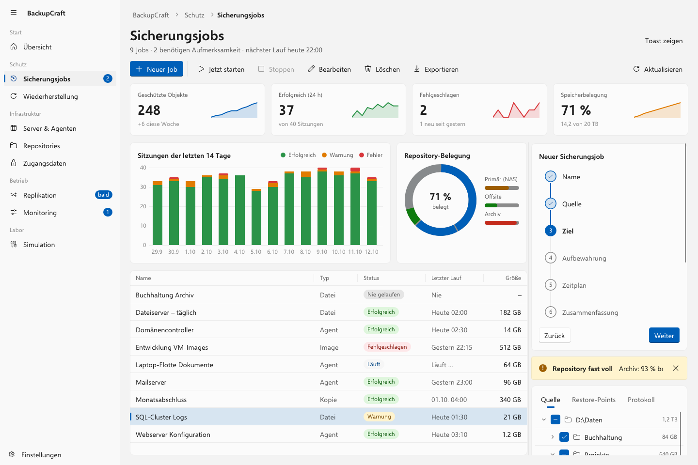 | 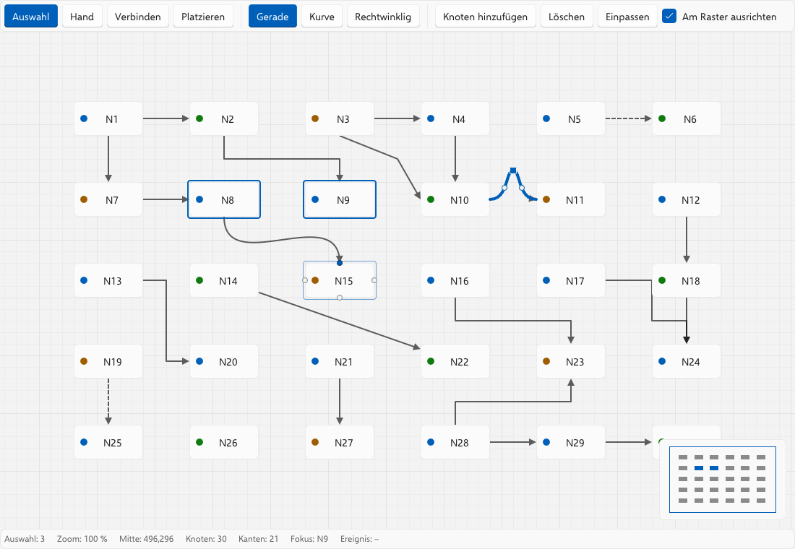 |

KPI cards with sparklines, a stacked bar chart, a donut, a sortable grid, steps of a wizard,
and a tree with check boxes; the diagram canvas with nodes and ports, straight, curved, and
right-angled edges, snapping to the grid, and a minimap.

| Rich-text editor (`editortest`) | Code editor (`editortest`) |
| --- | --- |
| 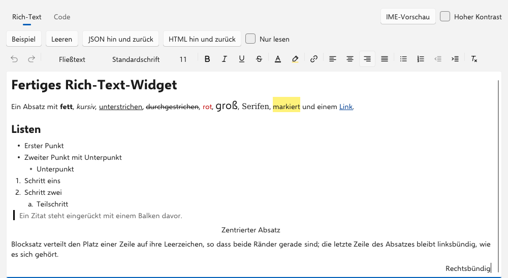 | 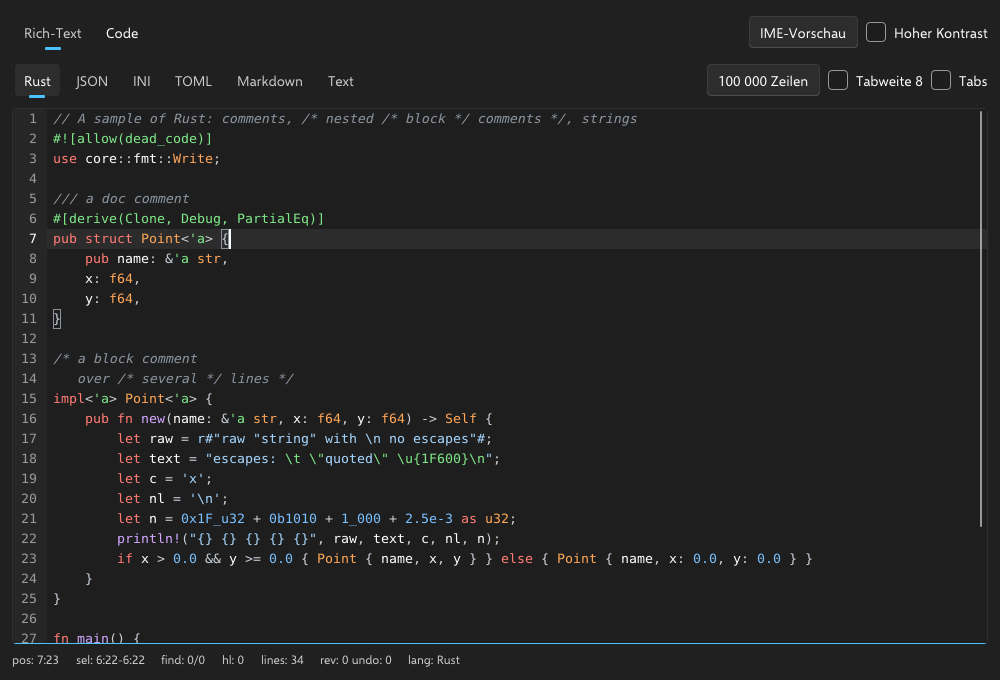 |

Headings, character formats, colors, fonts, lists, quotations, and alignments, with HTML in
and out; syntax highlighting, line numbers, find and replace, shown here in the dark theme.

| Drag and drop (`dndtest`) | Docking panels (`docktest`) |
| --- | --- |
| 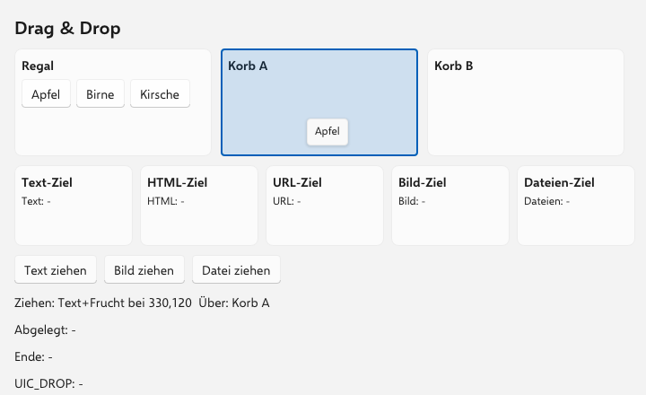 | 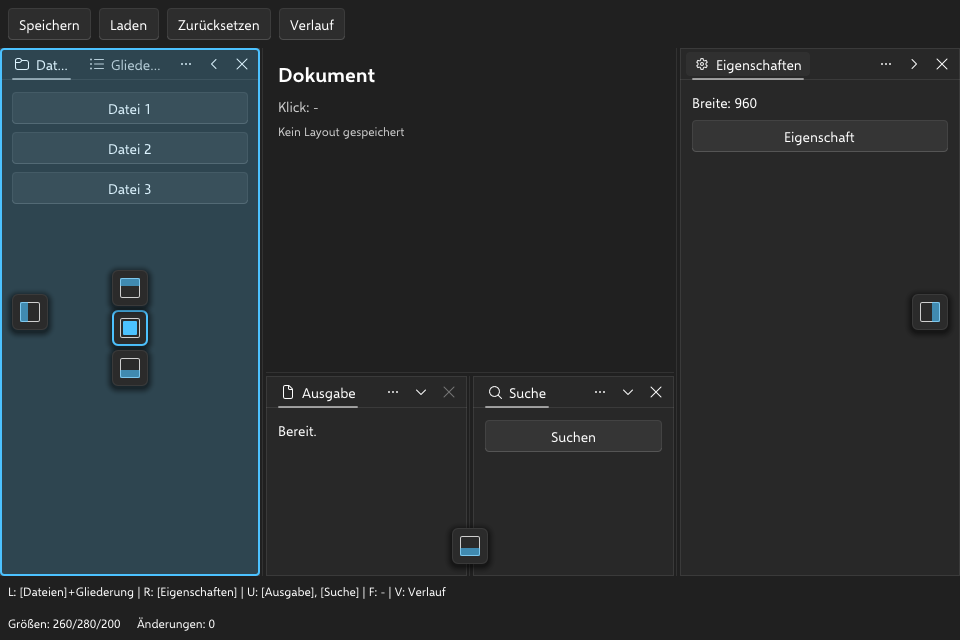 |

A drop target lights up and the dragged item follows the pointer; text, HTML, URLs, images,
and files also travel to and from other programs. Panels sit in tab groups, show drop markers
while they are dragged, float as tool windows, and keep their layout.

| High contrast (`datagallery --contrast high`) | Text scale 150 % (`gallery --text-scale 150`) |
| --- | --- |
| 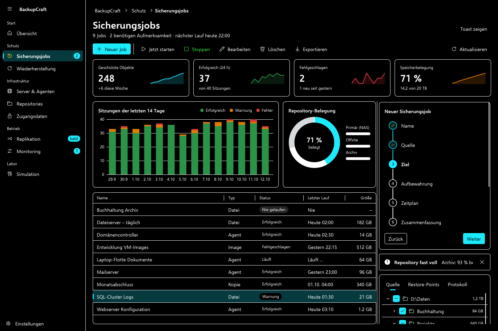 | 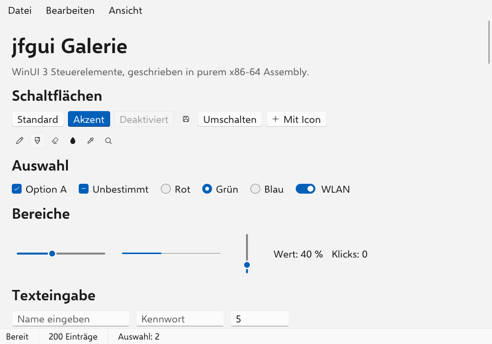 |

Both follow the system's settings by default. The text scale enlarges text and line heights
independently of the UI scale.

| SVG images (`svgtest`) | Live inspector (`gallery --inspect`) |
| --- | --- |
| 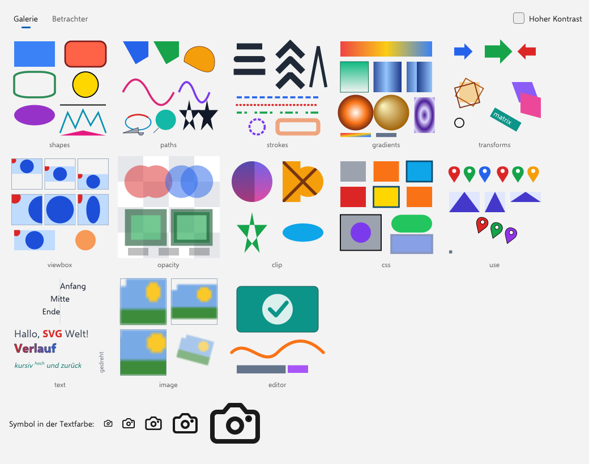 | 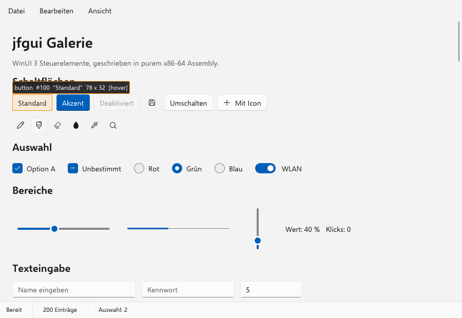 |

SVG files drawn by JFLIB's own rasterizer, and symbols in the text color at several sizes;
the inspector names the widget under the pointer and opens a tool window with the widget
tree, properties, a script selector, and frame statistics.

| Spell checking (`spelltest`) | Font dialog (`fontpicktest`) |
| --- | --- |
| 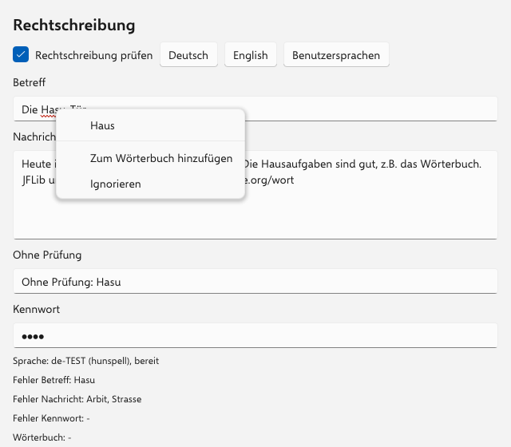 | 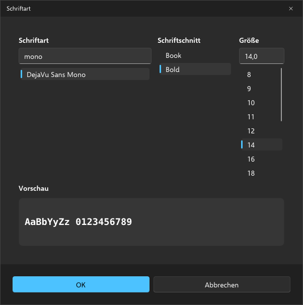 |

Misspelled words are underlined while typing, and the context menu offers suggestions and
the user's dictionary; the font dialog searches the installed fonts and previews the choice.

## Platforms

The following table describes the build paths available in the current repository:

| Platform | Output / build target | Status |
| --- | --- | --- |
| **Windows** | Native x86-64 app, `--target win` | Win32 windows and desktop integration |
| **Linux** | Native x86-64 app, `--target linux` | Wayland and X11; the backend is selected at startup |
| **Android** | Native APK, `--target android` | `androidGallery`, ARM64 and x86-64 emulator; Android 8 / API 26 or later |
| **macOS** | Browser output through `--target web` | Access through the web port; the current build script has no native Apple target |
| **iOS** | Browser output through `--target web` | Access through the web port; the current build script has no native iOS app/IPA target |
| **Web** | WebAssembly and a shared browser host, `--target web` | Includes `template`, `gallery`, `Kritzel`, `PaintCraft`, and `jfWord` |

The documented browser test matrix covers Chromium and Firefox. Separate Safari/iOS
validation has not yet been documented here. The `macos` style is independent of the
target platform: it can also be built into a Windows app, for example.

The Android port is currently available through the Pocket Gallery. The Android adapter
uses the system's file picker (Storage Access Framework, with access kept across restarts),
persistent app storage, and the system clipboard; other desktop services are more limited.
The [Android documentation](apps/androidGallery/README.md) describes the port and its
current limitations.

## Apps

Pass the app names in the first column exactly as written to `build_rs.py app NAME`.

| App | Description | Targets |
| --- | --- | --- |
| [`template`](apps/template/main.rs) | A click counter as a starting point for your own GUIs | Windows, Linux, Web |
| [`gallery`](apps/gallery/main.rs) | A widget gallery for exploring controls, layout, and styles | Windows, Linux, Web |
| [`Kritzel`](apps/Kritzel/README.md) | A drawing app with brushes, shapes, text, selections, and layers | Windows, Linux, Web |
| [`PaintCraft`](apps/PaintCraft/src/main.rs) | An image editor with layers, history, effects, many image formats, and native plugins | Windows, Linux, Web |
| [`jfWord`](apps/jfWord/README.md) | A word processor with a ribbon, page view, text styles, tables, references, and DOCX support | Windows, Linux, Web |
| [`buildManager`](apps/buildManager/README.md) | A graphical build app for applications, styles, profiles, tests, and release packages | Windows, Linux |
| [`BackupCraft`](apps/BackupCraft/README.md) | A backup suite: console, server (`bc-server`), agents (`bc-agent`), and `bcctl`; deduplicated, encrypted, signed backups with schedules, roles, and audit; copy jobs, replication with failover, continuous protection, tape, QEMU/KVM VMs with instant start and boot checks, volume images, a central view of several servers | Windows, Linux |
| [`JFNetworker`](apps/JFNetworker/README.md) | A network simulator and lab for distributed systems, an alternative to Cisco Packet Tracer: a topology editor with cables and port choice, IOS-like and Linux consoles, ARP, IPv4, VLANs, DHCP, DNS, TCP and HTTP byte for byte, a step-by-step simulation mode with event list and packet view, pcapng export; German and English | Windows, Linux |
| [`androidGallery`](apps/androidGallery/README.md) | A touch gallery with widgets, text input, and theme switching | Android; also Windows, Linux, and Web |

jfWord is under active development; full Word feature coverage and file compatibility
are not yet complete. Native plugins and operating-system services are more limited
in the browser than on the desktop.

PaintCraft now imports PSD/PSB raster layers, exports layered 8-bit PSD, offers
bitmap brush tips and dynamics, and connects to standalone G'MIC-Qt on Windows
and Linux. Its text tool supports OpenType shaping, bidirectional text and basic
IME composition display; English and French UI catalogs are available with German
fallback for untranslated strings. High-depth imports are converted to its 8-bit
SDR canvas. The [handbook comparison](apps/PaintCraft/docs/MANUAL_PARITY.md) lists
tested behavior and the remaining Photoshop, HDR and plugin limitations.
The optional classic Paint.NET DLL host now also connects to native Linux PaintCraft
through Wine. Brush Factory / Dynamic Draw JSON and legacy XML presets can be
imported for supported controls, with unsupported active parameters reported explicitly.
See the [Wine setup](tools/paintcraft-pdn-host/README.md#linuxwine-setup) and
[preset guide](apps/PaintCraft/docs/CREATIVE_TOOLS.md#brush-factory--dynamic-draw-presets).

PaintCraft's Rust sources are organized by domain under `apps/PaintCraft/src/`.
The [architecture guide](apps/PaintCraft/docs/ARCHITECTURE.md) covers application
state, documents, tools, effects, workspace components and external integrations.

**PaintCraft: dark WinUI style, with tools, colors, history, and layers**

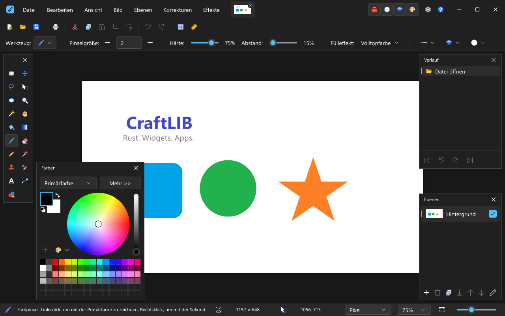

**BackupCraft: the jobs page in the dark backupcraft style (demo data)**

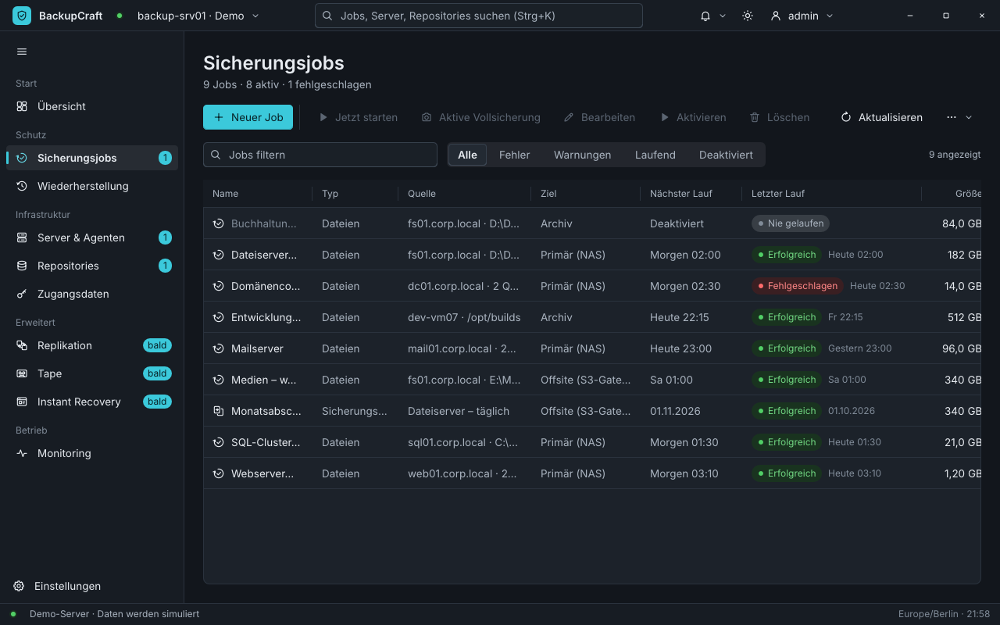

**jfWord: the same document view in the light and dark jfOffice style**

| Light | Dark |
| --- | --- |
| 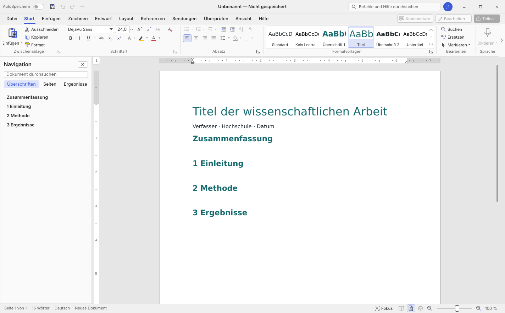 | 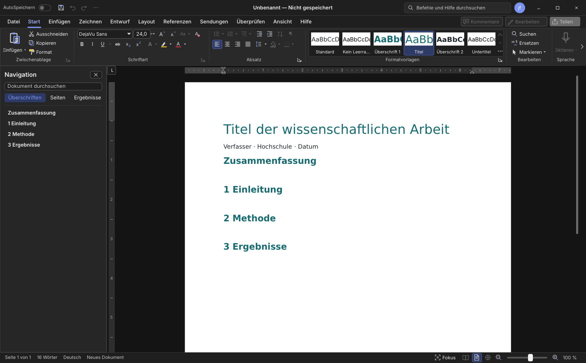 |

The images on this page were captured from the Rust apps and the GUI examples below,
using the built-in screenshot renderer on Windows. The Pocket Gallery image is a desktop
preview of the shared Android UI code; the Build Manager displays its bundled sample catalog.
The screenshots currently show German UI text; the code examples below use English labels.

## Building apps with Python

**Run all commands below from the root of this repository**, the directory containing
`build_rs.py`, `apps/`, `lib/`, and `styles/`.

### Prerequisites

- **Python 3**; the build tools use the standard library.
- **Rust installed through rustup**, with `rustc` and `cargo` on your `PATH`. The code targets Rust **1.98.x**.
- **LLVM / LLD**: `lld-link` for Windows, `ld.lld` for Linux, and `llvm-rc` for Windows
  app icons. `llvm-nm` is used for additional compiler checks. On Windows, the build
  script also checks `C:\Program Files\LLVM\bin` automatically; otherwise, the tools
  must be on your `PATH`.
- The appropriate **Rust target** for your desired output.

On systems where Python is named `python3`, replace `python` with `python3`.
Web and Android builds need the additional tools listed below.
The first build downloads the versions pinned in `lib/text_shape/Cargo.lock` from
crates.io. Later builds use Cargo's cache; `CARGO_NET_OFFLINE=true` enforces offline
use after that cache has been populated. No system HarfBuzz installation is needed.
Keep the generated `THIRD_PARTY_NOTICES.md` and `licenses/` folder with distributed
binaries; every package format and the APK include them automatically. They list the
third-party code, data, and fonts in JFLib with their licenses.

### Windows quick start

```powershell
rustup target add x86_64-pc-windows-msvc
python build_rs.py app gallery --target win
.\build\win\gallery.exe
```

### Linux quick start

```sh
rustup target add x86_64-unknown-linux-gnu
python3 build_rs.py app gallery --target linux
./build/linux/gallery
```

Displaying the Linux app requires an active Wayland or X11 session; building it does not
require a display. Windows can also build Linux output when the Linux Rust target and
`ld.lld` are installed. To run that output, the build script uses WSL, with `Ubuntu-24.04`
as the default distribution. Set `jfgui_WSL_DISTRO` to select a different distribution.

### Start your own app

```sh
python build_rs.py new hello --title "Hello"     # apps/hello: a window app that builds and passes its test
python build_rs.py test hello                    # build it, run apps/hello/tests/*.uis (Windows and Linux)
python build_rs.py run hello --target win
```

`--kind console`, `--kind tool` (a window plus a command line program on a shared crate) and
`--kind service` (a background service) start other kinds of programs; `--style kde` picks the
style. `python build_rs.py new --lib NAME --deps rt,plat` adds a library crate under `lib/`.
Every app gets its sources, `PERMISSIONS`, `PACKAGE` (its own `version=0.1.0`), `TARGETS`, a
smoke test and a README; the [developer guide](docs/GUIDE.md) (section 2) explains them.

### More apps and build options

```sh
# Build individual apps
python build_rs.py app Kritzel --target win
python build_rs.py app PaintCraft --target win
python build_rs.py app jfWord --target win

# Build Windows and Linux together; both Rust targets must be installed
python build_rs.py app jfWord --target both

# Build and launch; everything after -- is passed to the app
python build_rs.py run gallery --target win -- --theme dark

# Optimized build in build/release/win/
python build_rs.py app PaintCraft --target win --release

# Build all apps for a target, or just the library components
python build_rs.py all --target win
python build_rs.py lib --target win
```

| Option | Effect |
| --- | --- |
| `--target win` / `linux` / `web` / `android` | Build one target; the app must support it |
| `--target both` | Windows and Linux; the default for `app`, `lib`, and `all` |
| `--target all` | Windows, Linux, and Web where supported; Android is built separately |
| `--style kde` | Select a style; otherwise, use `apps/NAME/STYLE`, falling back to `winui` |
| `--style winui,classic,macos,kde,jfoffice` | Build several style variants in one invocation |
| `--release` | Optimized build with LTO; output defaults to `build/release/` |
| `--profile size` | Release profile tuned for smaller output; writes to `build/size/` |
| `--profile o2` | Optimized build without LTO; writes to `build/o2/` |
| `--out build/my-build` | Use a custom output directory, including for release builds |
| `-j 8` | Limit the number of concurrent compiler processes |

Development builds produce `build/win/NAME.exe` or `build/linux/NAME`.
When building multiple styles, the path also includes the style, for example
`build/win/classic/gallery.exe`. Selecting a single explicit style does not add this
subdirectory. Builds are incremental, and warnings are treated as build errors.
PaintCraft's additional modules, such as `jxlenc.dll` or `jxlenc.so`, are built automatically.

### Browser builds

```sh
rustup target add wasm32-unknown-unknown
rustup component add rust-src
python build_rs.py app gallery --target web
python tools/serve_web.py build/web/gallery
```

Then open [http://127.0.0.1:8766/](http://127.0.0.1:8766/). LLVM's `wasm-ld` is also
required. The default build includes scalar, SIMD128, and worker variants; the browser
host selects a variant based on available capabilities. The local server supplies the
isolation headers required for shared memory.

Use `--web-mode scalar` to build only the scalar variant, which does not require
`rust-src`. Other apps follow the same pattern, for example
`python build_rs.py app jfWord --target web`. See the
[web and agent infrastructure guide](docs/AGENT_WEB.md) and [WASM compute documentation](docs/WASM_COMPUTE.md).

### Android APKs

Additional requirements are **JDK 17+**, **Android SDK Platform 36**, **Build-Tools 35+**,
and **NDK r29**. `ANDROID_SDK_ROOT` / `ANDROID_HOME` and `ANDROID_NDK_HOME` can override
the automatically detected paths.

```sh
rustup target add aarch64-linux-android
python build_rs.py app androidGallery --target android
```

Output: `build/android/androidGallery-arm64-v8a-debug.apk`.
For an x86-64 emulator:

```sh
rustup target add x86_64-linux-android
python build_rs.py app androidGallery --target android --android-abi x86_64
```

Android builds use `rustc`, the SDK, and the NDK directly, without Gradle. Debug builds are
signed with a local debug key. `--release` signs with the release key named by
`jfgui_ANDROID_KEYSTORE`, `jfgui_ANDROID_KEYSTORE_PASS`, and `jfgui_ANDROID_KEY_ALIAS`
(`jfgui_ANDROID_KEY_PASS` if the key has its own password) and writes
`<app>-<abi>-release.apk`; without them the build stops and names what is missing
(`jfgui_ANDROID_DEBUG_SIGN=1` keeps the debug key for test builds; docs/PACKAGING.md,
"Signing"). Other apps need an Android entry in `TARGETS` and a suitable manifest and
resources.

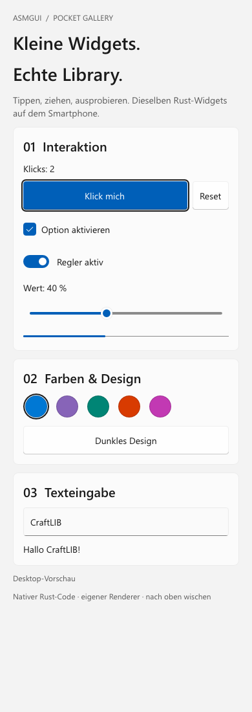

## Build Manager

The **Build Manager is itself a JFLIB app**. It provides a graphical workspace for
the existing Python build tools: select apps and styles, save profiles, prepare jobs,
track builds, run tests, and launch completed apps. Python, Rust, and LLVM are still
required when using the Build Manager.

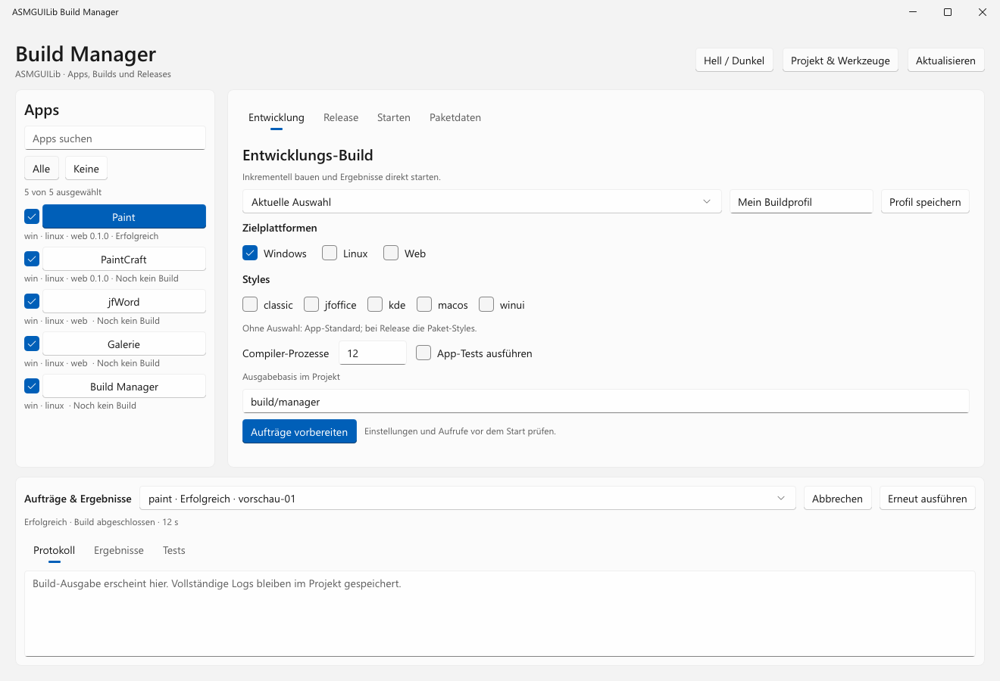

Build and launch it once:

```powershell
# Windows
python build_rs.py app buildManager --target win
.\build\win\buildManager.exe
```

```sh
# Linux
python3 build_rs.py app buildManager --target linux
./build/linux/buildManager
```

The current app uses German UI labels. The steps below include those labels so you can
find the corresponding controls:

1. Open **Project & Tools (Projekt & Werkzeuge)** and select the JFLIB directory
   or its `build_rs.py` if automatic detection fails. Check the Python path and,
   on Windows, the WSL distribution if needed.
2. Select apps on the left. Under **Development (Entwicklung)**, choose target
   platforms, optional styles, compiler processes, and app tests. Save the selection
   as a profile if desired.
3. Choose **Prepare jobs (Aufträge vorbereiten)**, review the displayed commands,
   and add the jobs to the queue.
4. Under **Jobs & Results (Aufträge & Ergebnisse)**, inspect logs, tests, and build
   outputs. Use **Launch (Starten)** to create launch profiles with a theme, scale,
   and additional arguments.
5. Use **Release** to prepare optimized builds and packages. **Package data (Paketdaten)**
   contains the metadata from `apps/APP/PACKAGE`.

The GUI currently offers **Windows, Linux, and Web** build targets. Build Android apps
through the Python script. Release packages need suitable package metadata and resources.
Windows installers require a Windows host; Debian packages require `dpkg-deb`
(through WSL on Windows). Output defaults to `build/manager/`, and profiles are saved
in `build-profiles.json`.

To build a package directly from the terminal, for example forCraft:

```sh
python tools/package.py PaintCraft --styles winui,classic --no-deb
```

This creates the Windows installer at `build/dist/PaintCraft_Setup.exe`.
`--formats all` also writes an AppImage, a Flatpak bundle, an MSIX package and an RPM .spec.
See the [Build Manager documentation](apps/buildManager/README.md) and
[packaging guide](docs/PACKAGING.md) for details.

## Small GUI examples

### A window with a click counter

Create `apps/hello/src/main.rs` with this complete app:

```rust
#![no_std]
#![no_main]
#![deny(unsafe_code)]

extern crate alloc;
use ui::*;

const DESC: AppDesc = AppDesc {
    title: "Hello JFLIB",
    flags: AF_RESIZABLE,
    w: 480,
    h: 300,
    min_w: 320,
    min_h: 240,
    ..AppDesc::NONE
};

#[derive(Default)]
struct Counter {
    clicks: u32,
}

impl App for Counter {
    fn frame(&mut self, ui: &mut Ui) {
        ui.box_begin(0, BOX_V | pad(24), 12);
        ui.text(TS_TITLE, "Hello JFLIB!");
        ui.text(TS_BODY, &alloc::format!("Clicks: {}", self.clicks));
        if ui.accent_button(100, "Click me") & EV_ACT != 0 {
            self.clicks += 1;
        }
        if ui.button(101, "Reset") & EV_ACT != 0 {
            self.clicks = 0;
        }
        ui.box_end();
    }
}

ui::main!(ui::launch(&DESC, Counter::default(), &style::STYLE));
```

```sh
python build_rs.py run hello --target win
# On Linux: python3 build_rs.py run hello --target linux
```

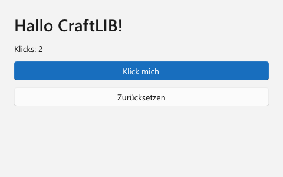

`AppDesc` describes the window, `Counter` holds the state, and `frame` describes the
widgets. Buttons report activation through `EV_ACT`. Sizes and spacing are expressed
in device-independent pixels (DIP); the library handles scaling. `style::STYLE` refers
to the style selected at build time.

### A text field, checkbox, and slider

In the example above, replace `Counter`, its `impl App`, and the `ui::main!` invocation
with this version. Keep the crate attributes, `extern crate alloc`, `use ui::*`, and
`DESC` unchanged:

```rust
#[derive(Default)]
struct Form {
    name: alloc::string::String,
    enabled: i32,
    value: i32,
}

impl App for Form {
    fn frame(&mut self, ui: &mut Ui) {
        ui.box_begin(0, BOX_V | PAD_16, 12);
        ui.text(TS_SUBTITLE, "Settings");
        ui.textbox(200, Some("Your name"), &mut self.name, 128);
        ui.checkbox(201, "Enable option", &mut self.enabled);
        ui.slider(202, &mut self.value, &Range::new(0, 100, 1, 0));
        ui.progress(203, self.value, 100);
        ui.text(TS_BODY, &alloc::format!("Value: {} %", self.value));
        ui.box_end();
    }
}

ui::main!(ui::launch(&DESC, Form::default(), &style::STYLE));
```

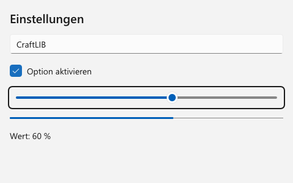

Values are updated directly through `&mut`. Checkboxes use `i32` (`0` / `1`), and
widget IDs must be unique within a frame. File operations, dialogs, and larger actions
can be dispatched to `App::command` through `ui.cmd_run(...)`.

New apps can use `src/main.rs`; existing flat `main.rs` projects are also supported.
Each app must have only one of these entry points. A `STYLE` file containing a name
such as `kde` sets the default style. A `TARGETS` file can explicitly list supported
targets, such as `win linux web`.
More examples: [template](apps/template/main.rs), [widget gallery](apps/gallery/main.rs),
and [developer guide](docs/GUIDE.md).

## Styles

The style is selected **at build time**. Light/dark themes, accent colors, and scaling
can change at runtime. The style and operating system are independent of each other.

| Style | Appearance |
| --- | --- |
| `winui` | Modern Windows/Fluent interface with rounded controls |
| `classic` | Classic gray interface with raised and sunken borders |
| `macos` | Controls and window decorations inspired by macOS |
| `kde` | Interface inspired by KDE Plasma/Breeze |
| `jfoffice` | Office style with its own typography, ribbon components, and blue accents |
| `backupcraft` | WinUI layers with KDE Breeze framing, petrol accent, compact controls, own icons |

**The same widget gallery with six styles and two themes:**

| WinUI · light | Classic · light |
| --- | --- |
| 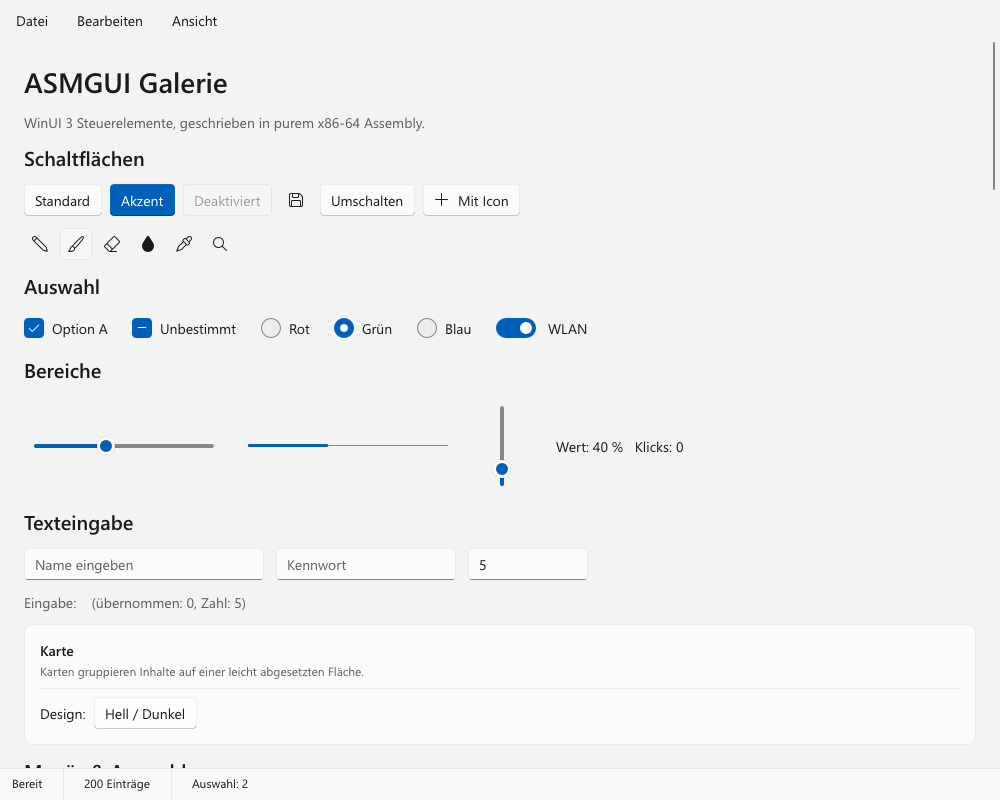 | 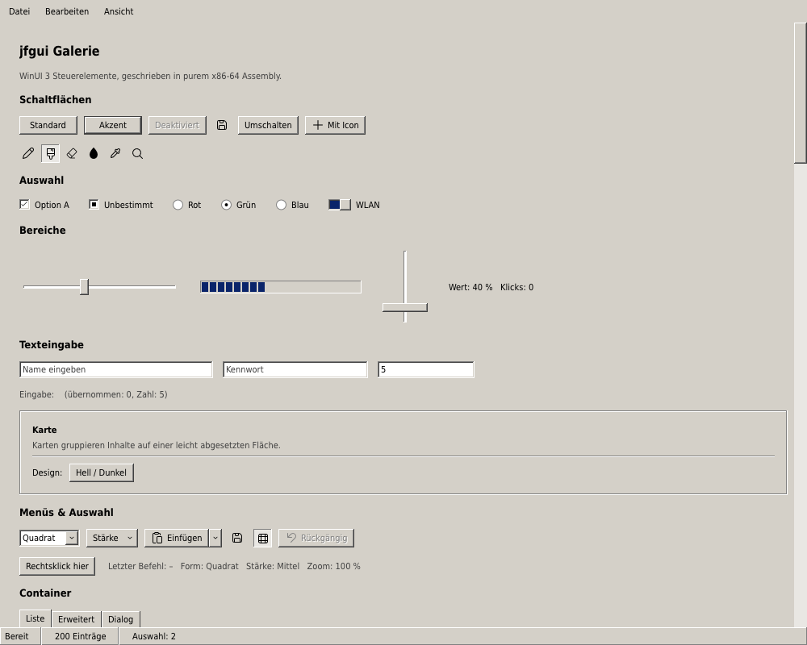 |

| macOS style · light | KDE style · light |
| --- | --- |
| 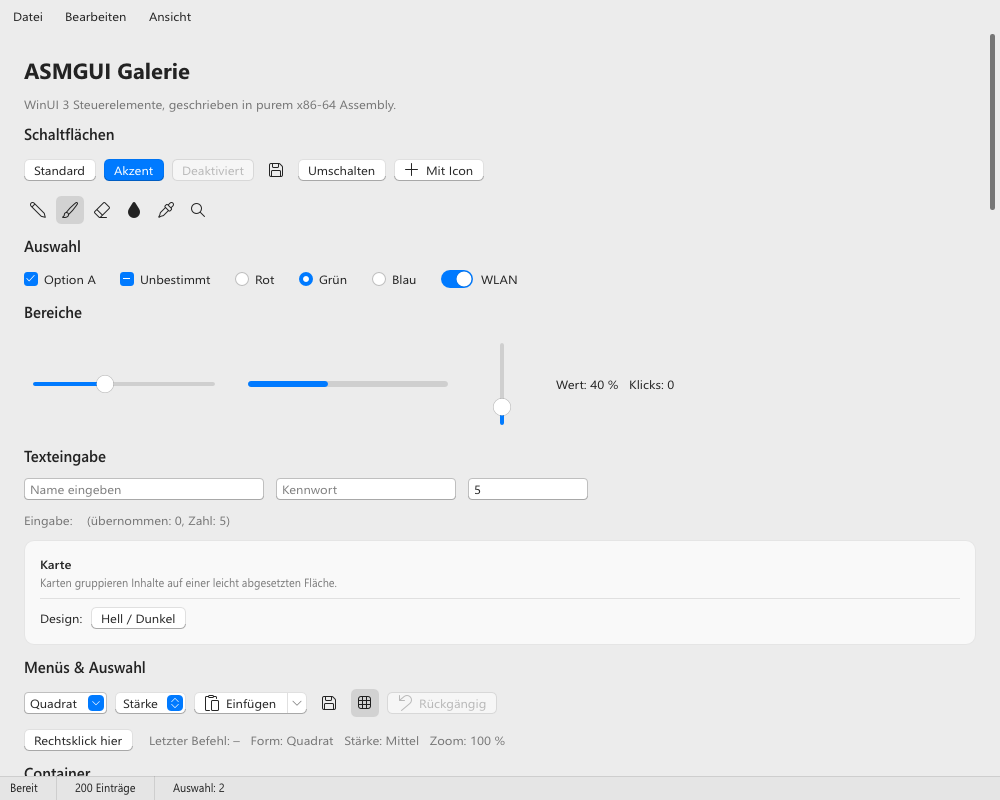 | 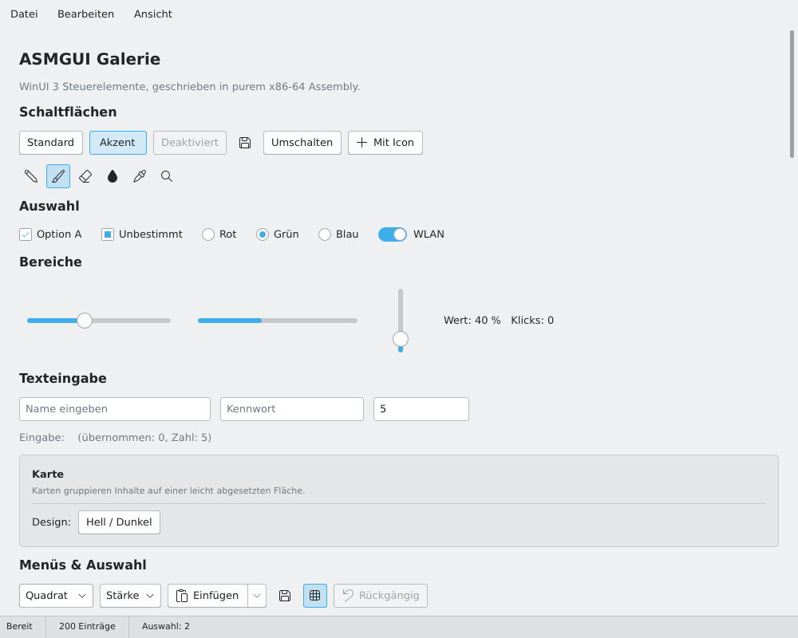 |

| jfOffice · light | WinUI · dark |
| --- | --- |
| 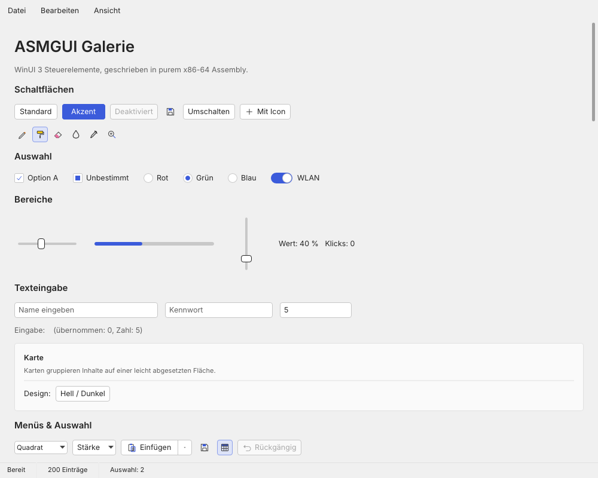 | 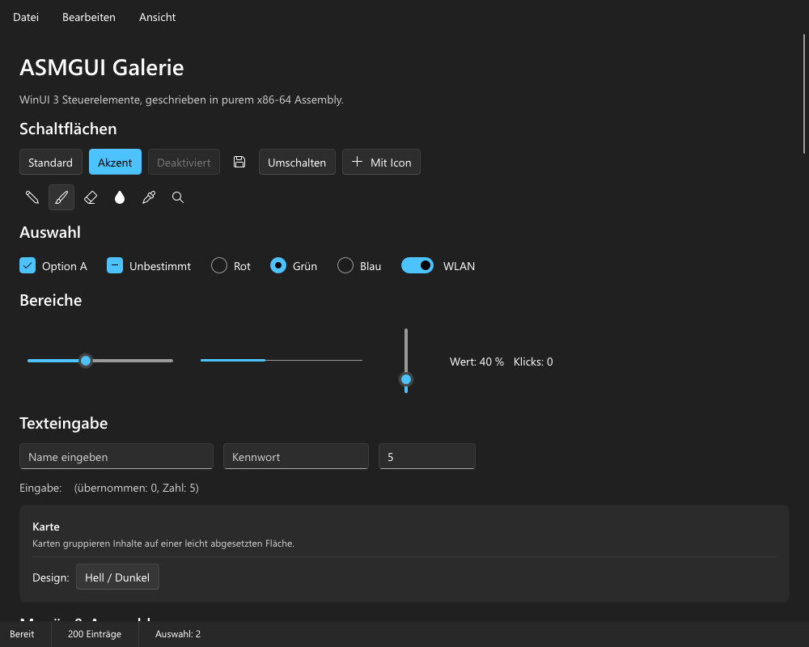 |

| BackupCraft · light |
| --- |
| 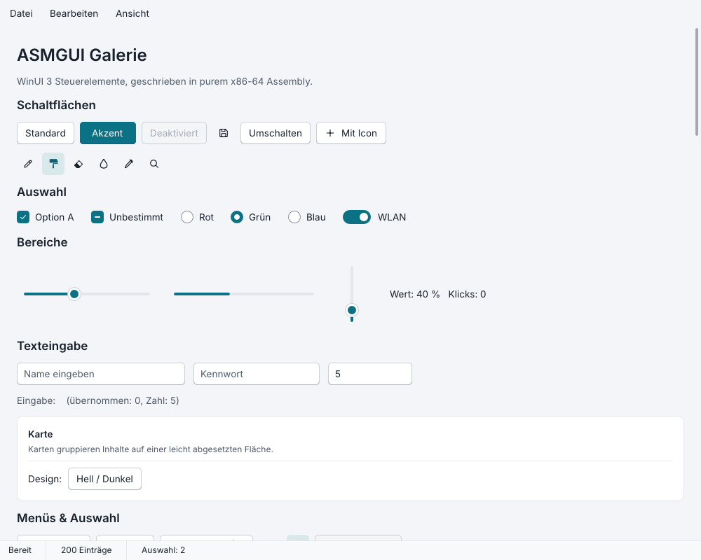 |

```sh
python build_rs.py app gallery --target win --style winui,classic,macos,kde,jfoffice,backupcraft
```

On Windows, launch `build/win/kde/gallery.exe` or `build/win/macos/gallery.exe`, for example.
For Linux, use the same build command with `--target linux`.

**The apps use the same styles. Here is Kritzel with Classic:**


```sh
python build_rs.py app Kritzel --target win --style classic --out build/kritzel-classic
python build_rs.py run gallery --target win -- --theme dark --scale 150
```

[STYLES.md](docs/STYLES.md) describes the style contract, creating custom styles, and
the origins of bundled font and icon assets. See [jfOffice](styles/jfoffice/README.md)
for more details about the Office style.

## Screenshots and checks

GUI apps can render directly to a PNG without opening a visible window:

```sh
python build_rs.py run gallery --target win -- --shot build/gallery.png --size 1000x800 --scale 100 --theme light --anim off
```

`--shot` saves the image and exits the app. To prepare particular views or interaction
sequences, use `.uis` scripts with commands such as `click`, `type`, `theme`, `expect`,
and `shot`. Run the existing template test with:

```sh
python build_rs.py run template --target win -- --script apps/template/tests/smoke.uis --verify-dirty
python build_rs.py check
python build_rs.py test --quick --target win
```

`check` validates the source-code rules. `test --quick` starts the broader test suite
and skips the historical assembly parity checks; `test NAME` builds one app and runs only its
scripts. `python build_rs.py api-diff` lists the changes of the public API since the last
release ([versions](docs/VERSIONING.md)). Some existing PaintCraft tests still
expect reference plugins under `build/rwref`, which are not included in a fresh checkout.
The full parity run also requires the separate assembly reference.
For rust-analyzer, `python build_rs.py ide` generates `rust-project.json`.

## Documentation

| Guide | Contents |
| --- | --- |
| [Developer guide](docs/GUIDE.md) | App model, layout, widgets, menus, dialogs, files, and scripted tests |
| [API reference](docs/API.md) | Library functions and types |
| [Styles](docs/STYLES.md) | Appearance, style interfaces, and assets |
| [Build Manager](apps/buildManager/README.md) | Profiles, queue, tests, launching, and releases |
| [Packaging](docs/PACKAGING.md) | Windows installers, Debian packages, AppImage, Flatpak, MSIX, RPM, icons, and package metadata |
| [Virtual files and assets](docs/VFS.md) | `app://`, `config://`, `data://`, `cache://`, `mem://`, mounts, and bundling `apps/NAME/assets` |
| [Permissions](docs/PERMISSIONS.md) | The `PERMISSIONS` manifest: files, programs, URLs, plugins, printing, secrets, autostart, sound, and network addresses an app may use |
| [Secrets](docs/SECRETS.md) | Passwords, tokens, and keys in the system's secret store (Credential Manager, Secret Service) |
| [Third-party notices](THIRD_PARTY_NOTICES.md) | Ported third-party code, Unicode data, fonts, and artwork with their copyright holders and licenses (texts in `licenses/`) |
| [Versions](docs/VERSIONING.md) | The library's version, the public API and its SemVer rules, deprecations, `build_rs.py api-diff` and releases |
| [Changelog](CHANGELOG.md) | What changed in each release of the library |
| [Roadmap](docs/ROADMAP.md) | What the library still lacks, with priorities (German) |
| [Android Gallery](apps/androidGallery/README.md) | APKs, Android prerequisites, input, and port status |
| [Web and agent control](docs/AGENT_WEB.md) | Browser host and explicit CLI/JSON/MCP interfaces |
| [PaintCraft plugins](plugins/README.md) | Native plugins and plugin builds |
| [jfWord](apps/jfWord/README.md) | Document editing and current feature coverage |
| [BackupJF](apps/BackupCraft/README.md) | Server, agents, console and bcctl: setup, architecture, security model, tests |

Some older documents still refer to a `RustLib/` directory. In this standalone
repository, that corresponds to the repository root.

| Directory | Contents |
| --- | --- |
| `lib/ui`, `lib/gfx`, `lib/text` | Widgets, runtime, layout, graphics, and text rendering |
| `lib/rt`, `lib/simd`, `lib/plat`, `lib/base` | Runtime, compute kernels, platform integration, and base types |
| `lib/img_*`, `lib/fx` | Image formats, image processing, and effects |
| `lib/doc_*`, `lib/archive` | Document model, layout, rendering, and file formats |
| `lib/agent_core`, `lib/agent_io` | Contracts and transports for optional app control |
| `lib/crypto`, `lib/compress`, `lib/datetime` | Cryptography, LZ4, time zones and cron schedules |
| `lib/netio`, `lib/datastore`, `lib/cas` | HTTP, TLS, SSH, DNS; the journal database; backup repositories |
| `styles/` | The six bundled styles |
| `apps/` | Applications, examples, and their tests |
| `plugins/`, `modules/` | Native extensions and loadable modules |
| `web/`, `android/` | Browser host and shared Android adapter |
| `tools/` | Build helpers, packaging, tests, and documentation tools |
| `docs/` | References, guides, and the screenshots used in this README |
| `build/` | Generated programs, library components, and test output |

### The documentation as a website

```sh
python build_rs.py site            # -> build/site/index.html, opens from the file system
python build_rs.py site --check    # build into a temporary folder and check links, anchors, images
```

`site` ([`tools/site.py`](tools/site.py), Python standard library only) turns this README, the
guides listed above, the changelog, the roadmap and the API reference into a static website: a
landing page, one page per section of the developer guide and per crate of the API reference, a
search over titles, headings and API items, and light and dark themes. The test suite runs the
check. Nothing is published automatically. One way to publish it is GitHub Pages: a workflow
that runs `python build_rs.py site` and hands `build/site/` to `actions/upload-pages-artifact`
and `actions/deploy-pages`; any static web host can serve the folder as well.

## License

JFLib is dual-licensed under the [MIT License](LICENSE-MIT) or the
[Apache License 2.0](LICENSE-APACHE), at your option. The apps PaintCraft, Kritzel and
BackupCraft are released under the MIT License (their `license.txt`). Third-party code,
data and fonts keep their own licences; see [THIRD_PARTY_NOTICES.md](THIRD_PARTY_NOTICES.md)
and [styles/NOTICE.md](styles/NOTICE.md).

Unless you explicitly state otherwise, any contribution intentionally submitted for
inclusion in JFLib by you, as defined in the Apache-2.0 license, shall be dual-licensed
as above, without any additional terms or conditions.

## Trademarks

Microsoft, Word, and Office are trademarks of Microsoft Corporation. Cisco, IOS, and
Packet Tracer are trademarks of Cisco Systems, Inc. These names appear only to describe
file formats, command-line conventions, and comparable products. JFLib and its apps are
independent projects and are not affiliated with, sponsored, or endorsed by Microsoft
or Cisco. Other product names may be trademarks of their respective owners.
