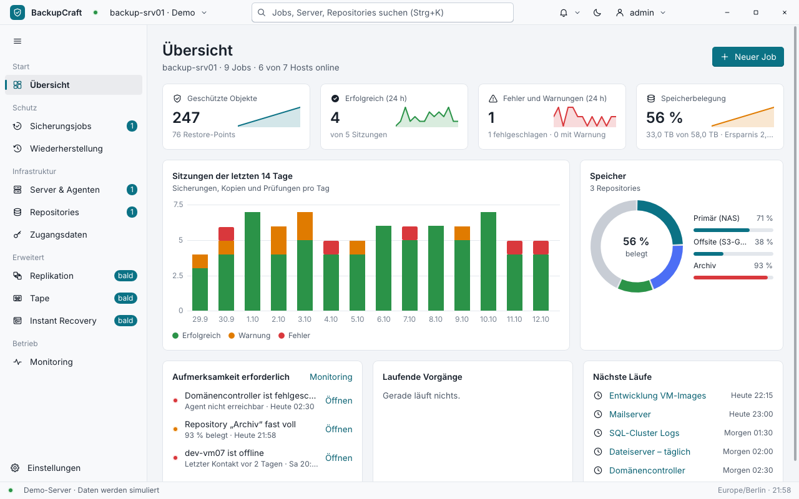

# BackupCraft

A backup suite built on JFLib: a desktop console, a backup server, agents for Windows and
Linux machines and a command-line client. Backups are deduplicated, compressed, encrypted and
signed; jobs run on schedules in any time zone; restore points can be made immutable; every
change is audited per user and role. Beyond files it backs up QEMU/KVM virtual machines and whole
volumes, copies points off site, writes them to (virtual) tape, keeps standby replicas with
failover and failback, protects folders continuously, starts VMs straight from a backup, checks
backups by booting them and watches other BackupCraft servers from one console.



| Program | Role |
| --- | --- |
| `BackupCraft` (`src/`) | The console: overview, jobs, restore, servers and agents, repositories, credentials, monitoring, settings, wizards |
| `bc-server` (`server/`) | The backup server: REST API, scheduler, backup and restore engine, repositories, users, roles, audit, its own CA |
| `bc-agent` (`agent/`) | Shares folders of a machine with one server over mutual TLS; pairs with a code or is installed over SSH |
| `bcctl` (`ctl/`) | Everything scripts need: setup, login, status, run, wait, restore, verify, logs, audit, updates, release signing; reads tapes without a server |

`apps/BackupCraft/BINS` lists the three further programs; `crates/` holds what they share:
`bc_proto` (data model, the one route table, JSON mapping), `bc_fs` (file metadata, safe
restore primitives, the rotating log), `bc_tape` (the tape format), `bc_vm` (QMP, qcow2,
the NBD server) and `bc_volume` (volumes, VSS / LVM snapshots).

## Quick start

```sh
python build_rs.py app BackupCraft --target win          # or --target linux / both
build/win/BackupCraft.exe --fixture                      # the console with demo data
```

### Setup assistant

The installed console (`BackupCraft_Setup.exe` / the .deb, see Packages) opens a setup
assistant on its first start (no `console.ini` yet; `--setup` or the sign-in page's
**Einrichtungsassistent** link open it again). It asks what this computer is:

* **Backup-Server auf diesem Computer** – data folder, reachable only here (HTTP on loopback) or
  on the network (TLS, names for the certificate), the first administrator, a repository. It
  then registers the service (`bc-server service install … --report FILE`, elevated: UAC on
  Windows, pkexec on Linux), sets the server up with the one-time token from the report, signs
  in, pins the CA, creates the repository and opens the job wizard.
* **Mit einem vorhandenen Server verbinden** – the sign-in page.
* **Diesen Computer sichern lassen (Agent)** – server address, pairing code, CA fingerprint and
  the folders; it runs `bc-agent pair … --service --report FILE` elevated.

There is no self-registration: the first administrator is created with the server's setup
token, further accounts under **Einstellungen › Benutzer & Rollen**.

### By hand

A real server on this machine (plain HTTP on loopback; it prints the one-time setup token):

```sh
build/win/bc-server.exe --data C:\BackupCraft\server
build/win/BackupCraft.exe --server http://127.0.0.1:7642
```

The console sees that the server is new and asks for the setup token and the first
administrator, then signs in. `bcctl setup --token T --user admin` does the same on the
command line.

On the network the server speaks TLS 1.3 with its own certificate authority:

```sh
bc-server --listen 0.0.0.0:7642 --name backup.corp.local,10.0.0.5
bc-server ca          # the CA certificate and its SHA-256 fingerprint
```

The console and `bcctl login` show the CA's fingerprint on the first connection and keep it once
it is trusted (`--ca FILE` trusts a CA file instead).

### Agents

*Pairing code:* in the console, **Server & Agenten → Agent koppeln** shows a one-time code (15
minutes), the server address and the CA fingerprint. On the machine:

```sh
bc-agent pair --server https://backup.corp.local:7642 --code ABCD-EFGH --fingerprint <SHA-256> --root /srv/data
bc-agent service install          # as administrator / root: a Windows service or systemd unit
```

`bc-agent pair … --service` pairs and installs the service in one go (as administrator / root).

*SSH push (Linux):* **Per SSH verteilen** asks for the address, shows the machine's host key
for comparison, takes stored credentials (password or an Ed25519 key) and uploads, pairs and
starts the agent: as root a systemd service, otherwise a background process of that user. A
second push updates the program and keeps the pairing.

`bc-agent roots --add DIR --restore-add DIR` changes the shared folders on the machine;
`--lock` forbids the server to change them.

### Services

```sh
bc-server service install --data /var/lib/backupcraft --listen 0.0.0.0:7642   # sudo / administrator
bc-server service status | start | stop | uninstall
```

`--report FILE` (server and `bc-agent pair`) writes the outcome as JSON for the setup
assistant: `ok`, `message` and, for a new server, its setup token and CA fingerprint.

Windows registers `BackupCraftServer` / `BackupCraftAgent` (automatic start as LocalSystem,
restart after a failure); Linux writes the systemd units `backupcraft-server` /
`backupcraft-agent`. Both log to standard output and `<data>/logs/*.log` (10 MB, five older
files kept).

### Packages

```sh
python tools/package.py BackupCraft
```

`build/dist/BackupCraft_Setup.exe` installs the console, `bc-server`, `bc-agent`, `bcctl` and
the Linux agent (`agents/linux-x86_64/`, for SSH pushes from a Windows server);
`build/dist/backupcraft_0.1.0_amd64.deb` installs them below `/usr/lib/backupcraft/`, links the
programs into `/usr/bin` and ships the systemd units (not enabled:
`systemctl enable --now backupcraft-server`).

## Architecture

```
BackupCraft (console) ──┐                 bcctl ──┐
                        ├── HTTP/1.1 + JSON, bearer token; loopback: HTTP, otherwise TLS 1.3
                        ▼                         ▼
                bc-server :7642 ── datastore (journal database) ── cas repositories
                        │ mutual TLS (own CA), the agent's certificate pinned
                        ▼
                bc-agent :7680 on protected machines (pairing code or SSH push)
```

**Server.** One process with a worker pool for the API and a scheduler (every 15 s: due jobs,
expired tokens, old operations). Long actions answer `202 {operation_id}` and run as
operations (at most eight at once, cooperative cancel); `GET /api/operations/{id}` follows
them. Operations and sessions that were running when the server stopped are marked
interrupted at the next start. `bcctl docs` lists every route with the role it needs (the
table in `crates/bc_proto/api.rs` that the server routes by).

**Users.** Argon2id passwords (at least 12 characters), tokens valid 24 h and kept only as a
BLAKE3 digest, a lock-out after failed logins, the roles viewer < restore < operator < admin per
route, an audit entry for every change (also for agents).

**Data directory of the server.** `db/` (datastore: snapshot + write-ahead journal, crash-safe),
`journal/` (audit and session logs), `keys/` (master, signing and recovery keys), `pki/` (CA,
server and client certificates; the keys sealed with the master key), `logs/`,
`config_backups/`, `setup.token` (until the setup). A set-up server does not start without its
keys.

**Repositories (`bcrepo-1`, lib/cas).** Content-defined chunking (FastCDC with a keyed gear
table), chunk ids = keyed BLAKE3 of the content, LZ4, XChaCha20-Poly1305 per chunk, packs with
an index, snapshots signed with Ed25519 and encrypted. Every restore point is a full image;
"incremental" means unchanged files (size, time, inode) take over their chunks. Retention by
count and grandfather-father-son, immutable points, garbage collection (mark & sweep with
repack), `check`, a recovery kit (X25519 sealed box over the repository key).

**Agents.** The server reaches an agent with its client certificate (CN
`BackupCraft Server`) and trusts exactly the certificate it issued at pairing; agents report every
30 s with their own certificate. An agent reads only inside its backup folders, writes only
inside its backup and restore folders, never follows a link below them (reads, folder
listings, restores), writes restored files to temporary files it names itself and renames them
when complete, and runs no commands. Removing a host revokes its certificate.

**Restores.** Users with the restore role restore only into allowed folders and never replace
files; operators may restore to the original place and replace. Names from a restore point are
checked; a link planted in the target cannot redirect the data; existing files are skipped,
renamed (`name (wiederhergestellt).ext`) or replaced.

**The libraries it brought into JFLib.** `crypto` (SHA-2 incl. SHA-384, BLAKE2b, BLAKE3,
HMAC/HKDF, Argon2id, ChaCha20-Poly1305 / XChaCha, AES-GCM, X25519, Ed25519, RSA PKCS#1 / PSS,
ECDSA P-256 / P-384, P-256 key exchange, sealed boxes), `compress` (LZ4, zstd), `datetime`
(zones with DST, cron), `datastore`, `cas`, `netio` (HTTP/1.1 server and client, TLS 1.3 and a
TLS 1.2 web client, X.509 path building, the system's trust store, SMTP, SSH-2, DNS, trust on
first use), `plat` (threads and locks, TCP / UDP / Unix sockets, file metadata, file watching,
processes, services), and the ui widgets for data views and app shells (grids, trees,
navigation panes, command bars, splitters, wizards, charts, toasts, date and time inputs). See
[docs/API.md](../../docs/API.md) and [docs/GUIDE.md](../../docs/GUIDE.md).

## Beyond the core

Every feature below has its capability (`GET /api/capabilities`); a server without it answers
`501 {code: "capability"}` and the console shows the page as announced.

**Compression.** LZ4 or zstd (level 3, or 6 for "Hoch") per job; zstd is JFLib's own
(`lib/compress/zstd`, RFC 8878: FSE, Huffman, repeat offsets, checksums).

**Notifications.** E-mail through SMTP (STARTTLS, TLS or plain on loopback; AUTH PLAIN / LOGIN,
never in clear), web hooks (JSON POST), on failures or every session, and a daily summary at a
set time. Public servers are checked against the system's certificate authorities (TLS 1.3, and
TLS 1.2 with ECDHE for the web); a company CA can be added (`smtp.ca`).

**Updates.** A signed manifest (Ed25519; `bc_proto::RELEASE_KEYS` and the setting `update.key`)
names the packages per platform with their SHA-256; the server checks the channel, downloads
and verifies the package (`bcctl update`), the dashboard shows a newer version.
`bcctl release keygen` / `release manifest` sign a release without a server.

**Copy jobs.** The points of a job into a second repository (off site, 3-2-1): trees are
rebuilt there (chunk ids are keyed per repository) and a map of copied trees keeps later copies
incremental; without a schedule a copy follows every good run of its source.

**Replication.** A replica keeps a job's newest point ready in a folder of a host (the server or
an agent), mirrored after every new point (unchanged files stay, what the point lacks goes).
*Failover* uses it instead of the original; *failback* backs up its folders as a point of the
job and writes them back to the original places (nothing is deleted there); *undo* drops the
failover. Failover plans switch several replicas in order with a pause between them.

**Continuous protection (CDP).** A file job with CDP watches its sources (Windows
ReadDirectoryChangesW, Linux inotify; agents report their changes through a long poll) and makes
a point soon after changes, at most once per RPO (15 s to a day). Folders without changes are
taken over from the previous point without listing them; a run without changes makes no point.
All CDP points of the last hours stay besides the normal retention.

**Fleet.** A central server watches other BackupCraft servers: each of them issues a fleet token
(it reads that server's report and nothing else); the central server pins the other's CA by its
fingerprint, asks every minute and shows their jobs, sessions, storage and alerts on its own
dashboard. Plain http only on loopback.

**Tape.** A virtual tape library on disk (one file per tape, format `bc_tape`: checked blocks,
one key per set when the media pool encrypts, that key also sealed to the recovery kit on the
tape). Media pools with write protection; a point is written completely, spanning tapes when
one is full; tape jobs write a job's newest point; restore and verify read only the tapes;
rescanning catalogs tapes that came back or came from elsewhere. `bcctl tape list|extract`
reads tapes without any server (encrypted sets with the recovery kit).

**Virtual machines (QEMU/KVM, on the backup server).** VMs are found through their QMP sockets
(setting `hypervisor.qmp`). A running VM is backed up by QEMU itself in one transaction over its
disks (crash-consistent) with a persistent dirty bitmap: the next run reads only the changed
blocks. Disks are stored in 1 MiB blocks, block i = chunk i. A VM that is off is read from its
disk files.

**Instant start.** A VM boots straight from a restore point: the server exports its disks
over NBD from the repository (read-only), a qcow2 overlay takes the guest's writes. *Merge*
mirrors the disks into a folder while the VM runs and switches over; *stop* discards the overlay.

**Boot checks.** A VM of a point starts without network access (or isolated, with one forwarded
port) and is checked: it keeps running, its serial console shows a text, it answers on a port.
Then everything is discarded and the result is kept.

**Volumes.** Whole volumes of the backup server block by block through a VSS shadow copy
(Windows) or an LVM snapshot (Linux), in 1 MiB blocks (unchanged blocks are stored once); a point
holds `volume.raw` (the image) and `volume.json`. An image file can stand for a volume.

## Tests

| Command | What |
| --- | --- |
| `python build_rs.py test` | the console's scripts (`tests/*.uis`: pages, setup assistant, job and volume wizards, replication, fleet, tape, instant start) with every other app |
| `python apps/BackupCraft/tests/setup_smoke.py` | the setup assistant end to end (`BC_SETUP_NO_SERVICE=1`: the server as the console's child instead of a service): data folder, first administrator, sign-in, repository, job wizard |
| `build/win/coretest.exe` | the foundation crates: crypto vectors (incl. AES-GCM, RSA, ECDSA, P-256), LZ4, zstd, plat, datastore, HTTP, cas, TLS, SSH, DNS |
| `python apps/BackupCraft/tests/http_smoke.py` | the REST API: setup, logins, roles, audit, repositories, jobs, backup, restore, verify, immutability, compression, copy jobs |
| `python apps/BackupCraft/tests/agent_smoke.py` | HTTPS, pairing, heartbeats, folders, backups from and restores to an agent, link rules, revocation, bcctl over https, replicas and CDP on agents |
| `python3 apps/BackupCraft/tests/push_smoke.py` | (Linux) the SSH push end to end against a test SSH server |
| `notify_smoke.py`, `update_smoke.py` | e-mail (a local SMTP server with STARTTLS), web hooks, daily summary; signed update manifests, download, tampering |
| `replication_smoke.py`, `cdp_smoke.py` | replicas, failover, failback, undo, plans; continuous protection: RPO, changed paths, exclusions, the CDP window |
| `fleet_smoke.py` | two servers: fleet tokens, CA pinning, reports and their states, revocation, the dashboard |
| `tape_smoke.py` | pools, spanning, restore and verify from tape, encryption, tape jobs, a missing tape, protection, another server reading the tapes, `bcctl tape` |
| `vm_smoke.py` | (Linux with QEMU, nasm) VM backups full and incremental, cold VMs, instant start, merge, boot checks; the guest is `tests/guest/boot.asm` |
| `volume_smoke.py` | an image file as volume (Linux): full, byte for byte, two changed blocks; Windows: the list and the VSS rights |
| `tests/volume_admin.ps1`, `tests/volume_root.sh` | as administrator / root: VSS on a VHDX, LVM on a loop device |
| `python tools/bc_cross.py` | Windows server with a Linux agent and a Linux server with a Windows agent (WSL) |
| `python tools/tls_interop.py`, `tools/ssh_interop.py`, `tools/tls_web_check.py` | TLS against OpenSSL, curl and Python; SSH against OpenSSH's client; the web client against public test servers |
| `python tools/crypto_check.py`, `tools/lz4_check.py`, `tools/zstd_check.py`, `tools/bc_crash.py` | random comparisons with Python's libraries and the zstd tool, kill -9 rounds during backups |
| `python tools/bc_i18n.py` | every console text has its English translation |

The Python tests take `--server` / `--bin` for the Linux builds (`wsl.exe -d Ubuntu-24.04 --
python3 ...`).

## Current limits

* Hyper-V is not supported (its tile stays "bald"); VMs, instant start, boot checks and
  volume backups run on the backup server itself (Linux with QEMU/KVM for VMs), not on agents.
* VM backups are crash-consistent (no guest agent quiesces the file systems); a merged VM keeps
  running under the server's QEMU until it is stopped; instant VMs end with the server.
* Volume backups need administrator (VSS) or root (LVM) rights and read the whole volume each
  time (dedupe keeps the storage small); they are restored as an image file.
* Tapes are virtual (files); real tape drives are not driven.
* TLS to public servers: no revocation checks (CRL / OCSP); name constraints cover DNS names
  and IP addresses; P-384 certificates are verified, P-384 key exchange is not offered;
  AES-GCM runs in portable code (about 33 MB/s).
* Failback writes the replica's state back but deletes nothing at the original; CDP on files a
  Linux system sees through a Windows mount (WSL `/mnt/c`) gets no change events.
* `bc_proto::RELEASE_KEYS` is empty: a server trusts update manifests only with `update.key`.
* The SSH push installs on Linux x86-64; Windows machines pair with a code and
  `bc-agent service install`.
* The setup and the .deb only install the programs; the console's setup assistant registers
  the service (the .deb's units are not enabled). The service install itself (UAC / pkexec) has
  no automatic test: `setup_smoke.py` starts the server as a child.
* Agent certificates are valid for one year; renewing them means pairing again for now.
* On Linux a stop request ends the server at once; its data stays consistent (journal,
  write-ahead order), running sessions are marked interrupted at the next start.
