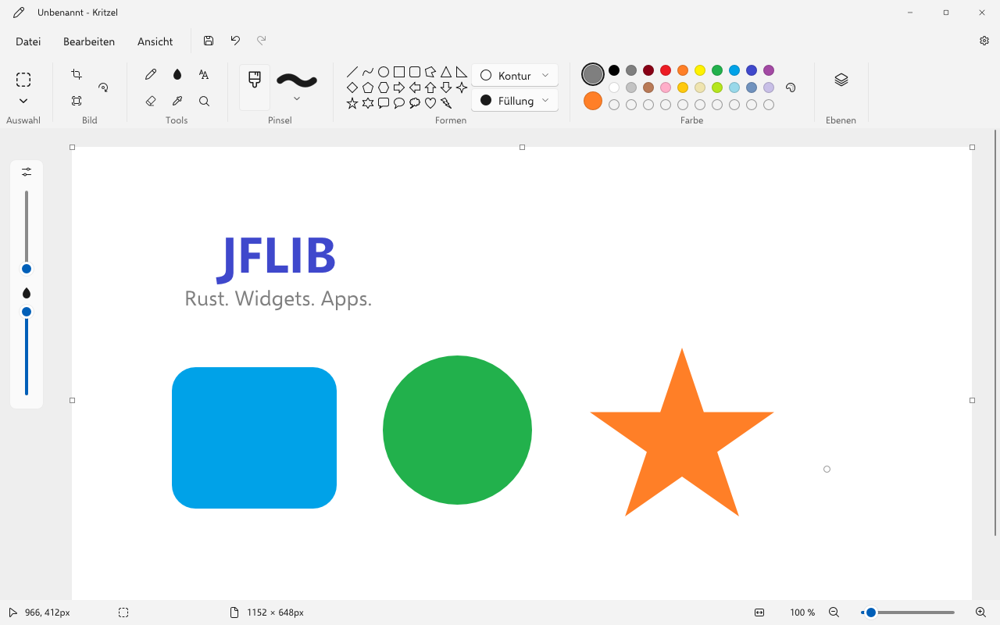
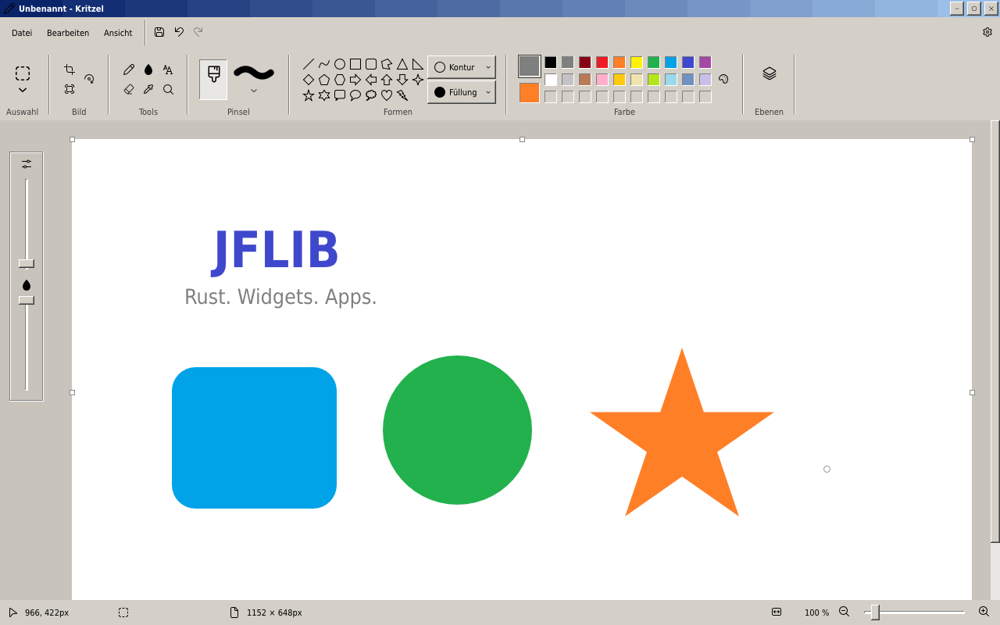

# Kritzel

Kritzel is a drawing and image-editing app in the spirit of classic desktop drawing
programs, written in Rust with [JFLib](../../README.md). It provides a toolbar with
brushes, shapes, text, selections, and a layer panel in a compact desktop interface.

Use it for sketches, annotations, cropping, resizing, and simple image edits. For
more image formats, layered PDN documents, effects, and plugins, see
[JFPainter](https://github.com/JFLibrary/JFPainter).



*Kritzel with the WinUI style and light theme, here with its German labels. The app follows the
user's language: German or English (`locales/ui.tsv`).*

## Features

- **Drawing tools:** pencil, eraser, flood fill, color picker, and nine brush
  variants, including calligraphy, airbrush, oil, crayon, marker, and watercolor.
- **Shapes and text:** 23 built-in shapes, including lines, curves, arrows, stars,
  and callouts; outline/fill controls and formatted text.
- **Colors:** primary and secondary colors, palette swatches, custom colors,
  brush size, and opacity controls.
- **Selections:** rectangular and free-form selections; move, resize, rotate,
  flip, cut, copy, paste, and crop selected content.
- **Layers:** up to 16 layers with thumbnails, visibility and opacity controls,
  duplication, reordering, and merging.
- **Image operations:** resize the image or canvas, rotate, flip, crop, and skew;
  undo and redo; zoom, pan, and fit the canvas to the window. On Windows a pan comes from
  GPU textures, byte for byte what the CPU draws ([GPU.md](../../docs/GPU.md)).
- **Appearance:** shared JFLib styles, light/dark themes, and UI scaling.

## Supported file formats

Kritzel exposes the four core image formats below for opening and saving.

| Format | Extensions | Open | Save | Notes |
| --- | --- | :---: | :---: | --- |
| PNG | `.png` | Yes | Yes | Lossless; suitable for drawings and transparent images. |
| JPEG | `.jpg`, `.jpeg`, `.jpe`, `.jfif` | Yes | Yes | Lossy; no alpha channel. |
| BMP | `.bmp`, `.dib` | Yes | Yes | Windows bitmap images. |
| GIF | `.gif` | Yes | Yes | Indexed color; opens the first frame of animated GIFs and saves a single image. |

**Saving flattens the document.** Layers remain editable during the session, but
the saved file contains their composited result. Reopening it creates a document
with one image layer. There is currently no layer-preserving Kritzel project format.
Text and shapes also become raster pixels when committed.

The canvas uses 8-bit color channels, and Kritzel has no animation editor. Additional
JFLib codecs such as TIFF, WebP, AVIF, HEIC, JPEG XL, PDN, and PSD are available
through [JFPainter](https://github.com/JFLibrary/JFPainter#supported-file-formats); they are not
wired into this app's file workflow.

## Build and run

Kritzel is an app of the JFLib repository. Cargo builds it in its folder, the same on Windows,
Linux and macOS (the app name is case-sensitive: **`Kritzel`**):

```sh
cd apps/Kritzel
cargo run                                        # build and start
cargo run -- --open "C:\Pictures\example.png"    # with an image
cargo run -- --theme dark --scale 150            # theme and scale are chosen at launch
cargo build --release                            # opt-level 2 + LTO: target/release/
```

You need Rust through rustup (the repository targets 1.98.x) and what the
[shared prerequisites](../../README.md#prerequisites) list for your system. Running the desktop app
on Linux requires a Wayland or X11 session.

The app's targets are `win`, `linux`, and `web`; dedicated native Android, macOS, and iOS app
targets are not currently provided. Its browser build comes from the repository's tool, as for its
other apps ([other targets](../../README.md#other-targets-and-packages)). The style is chosen when
building: the dependency `style` in `apps/Kritzel/Cargo.toml` names it (`jflib-style-winui`).

### Build Manager

The same build can be configured through the graphical
[Build Manager](../buildManager/README.md):

```sh
cd apps/buildManager
cargo run
```

Select the JFLib repository and **Kritzel**, choose the target and style under
**Development (Entwicklung)**, then select **Prepare jobs (Aufträge vorbereiten)**
and add the jobs to the queue. The GUI still requires Python, Rust, and LLVM. See
the [Build Manager walkthrough](../../README.md#build-manager) for launch profiles,
release builds, and packages.

## Classic style



*The same app with JFLib's Classic style.*

To build this variant, let the dependency `style` in `apps/Kritzel/Cargo.toml` name the Classic
style, then `cargo run` as above:

```toml
style = { package = "jflib-style-classic", path = "../../styles/classic" }
```

## Work in progress and current limits

- **Layer-preserving files:** the app has an editable layer stack, but PNG, JPEG,
  BMP, and GIF exports are flattened. A dedicated project format is not implemented.
- **More file formats:** the Open/Save workflow currently exposes only the four
  core formats above; wider format support is available in JFPainter.
- **Accessibility:** remains a shared [JFLib TODO](../../Todo.md).
- **Plugins:** Kritzel has no plugin host. Work on original paint.net plugin
  compatibility belongs to [JFPainter](https://github.com/JFLibrary/JFPainter#original-paintnet-plugins).

## License

Kritzel is released under the MIT License; see [license.txt](license.txt).

## Related documentation

- [JFLib library and app overview](../../README.md)
- [Build Manager](../buildManager/README.md)
- [Shared UI styles](../../README.md#styles)
- [Packaging guide](../../docs/PACKAGING.md)
- [JFPainter and its extended format support](https://github.com/JFLibrary/JFPainter)
