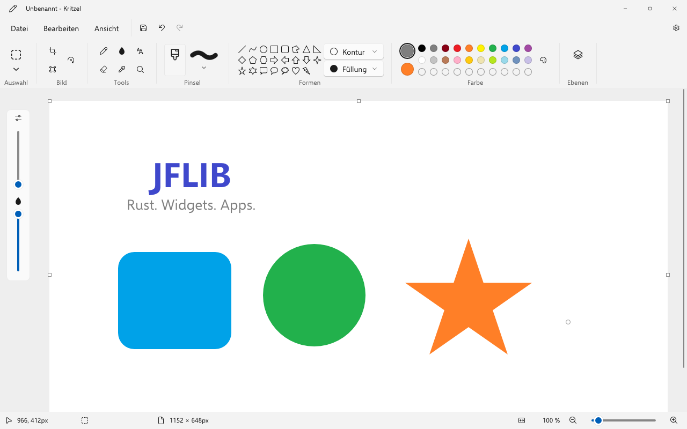
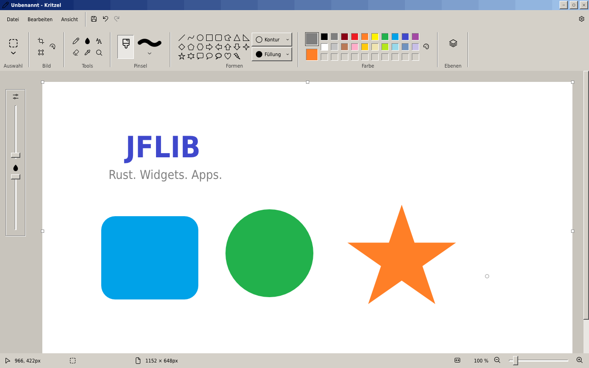

# Kritzel

Kritzel is a drawing and image-editing app in the spirit of classic desktop drawing
programs, written in Rust with [JFLib](../../README.md). It provides a toolbar with
brushes, shapes, text, selections, and a layer panel in a compact desktop interface.

Use it for sketches, annotations, cropping, resizing, and simple image edits. For
more image formats, layered PDN documents, effects, and plugins, see
[PaintCraft](../PaintCraft/README.md).



*Kritzel with the WinUI style and light theme. The current app UI uses German labels.*

## Features

- **Drawing tools:** pencil, eraser, flood fill, color picker, and nine brush
  variants, including calligraphy, airbrush, oil, crayon, marker, and watercolor.
- **Shapes and text:** 23 built-in shapes, including lines, curves, arrows, stars,
  and callouts; outline/fill controls and formatted text.
- **Colors:** primary and secondary colors, palette swatches, custom colors,
  brush size, and opacity controls.
- **Selections:** rectangular and free-form selections; move, resize, rotate,
  flip, cut, copy, paste, and crop selected content.
- **Layers:** up to 16 layers with thumbnails, visibility and opacity controls,
  duplication, reordering, and merging.
- **Image operations:** resize the image or canvas, rotate, flip, crop, and skew;
  undo and redo; zoom, pan, and fit the canvas to the window.
- **Appearance:** shared JFLib styles, light/dark themes, and UI scaling.

## Supported file formats

Kritzel exposes the four core image formats below for opening and saving.

| Format | Extensions | Open | Save | Notes |
| --- | --- | :---: | :---: | --- |
| PNG | `.png` | Yes | Yes | Lossless; suitable for drawings and transparent images. |
| JPEG | `.jpg`, `.jpeg`, `.jpe`, `.jfif` | Yes | Yes | Lossy; no alpha channel. |
| BMP | `.bmp`, `.dib` | Yes | Yes | Windows bitmap images. |
| GIF | `.gif` | Yes | Yes | Indexed color; opens the first frame of animated GIFs and saves a single image. |

**Saving flattens the document.** Layers remain editable during the session, but
the saved file contains their composited result. Reopening it creates a document
with one image layer. There is currently no layer-preserving Kritzel project format.
Text and shapes also become raster pixels when committed.

The canvas uses 8-bit color channels, and Kritzel has no animation editor. Additional
JFLib codecs such as TIFF, WebP, AVIF, HEIC, JPEG XL, PDN, and PSD are available
through [PaintCraft](../PaintCraft/README.md#supported-file-formats); they are not
wired into this app's file workflow.

## Build and run

**Run these commands from the JFLib repository root**, where `build_rs.py` is
located. The app name is case-sensitive: **`Kritzel`**.

You need Python 3, Rust through rustup, and LLVM/LLD. The repository targets Rust
1.98.x and builds directly with `rustc` through its Python script. See the
[shared build prerequisites](../../README.md#prerequisites) for tool paths and
platform setup. Use `python3` instead of `python` where required.

### Windows

```powershell
rustup target add x86_64-pc-windows-msvc
python build_rs.py app Kritzel --target win
.\build\win\Kritzel.exe
```

To build and launch with an image:

```powershell
python build_rs.py run Kritzel --target win -- --open "C:\Pictures\example.png"
```

### Linux

```sh
rustup target add x86_64-unknown-linux-gnu
python3 build_rs.py app Kritzel --target linux
./build/linux/Kritzel
```

Running the desktop app requires a Wayland or X11 session. See the
[Linux build notes](../../README.md#linux-quick-start) for cross-building and WSL.

### Browser / WebAssembly

```sh
rustup target add wasm32-unknown-unknown
rustup component add rust-src
python build_rs.py app Kritzel --target web
python tools/serve_web.py build/web/Kritzel
```

Open [http://127.0.0.1:8766/](http://127.0.0.1:8766/). LLVM's `wasm-ld` is required.
For a smaller build that does not need `rust-src`, add `--web-mode scalar` to the
build command. See the [browser build guide](../../README.md#browser-builds) for
the SIMD and worker variants.

This app currently has `win`, `linux`, and `web` build targets. Dedicated native
Android, macOS, and iOS app targets are not currently provided.

### Release builds and styles

```sh
# Optimized Windows build: build/release/win/Kritzel.exe
python build_rs.py app Kritzel --target win --release

# Separate style variants: build/win/<style>/Kritzel.exe
python build_rs.py app Kritzel --target win --style winui,classic,macos,kde,jfoffice
```

Styles are selected when building. Theme and scale can be selected when launching:

```powershell
.\build\win\Kritzel.exe --theme dark --scale 150
```

### Build Manager

The same build can be configured through the graphical
[Build Manager](../buildManager/README.md):

```powershell
python build_rs.py app buildManager --target win
.\build\win\buildManager.exe
```

Select the JFLib repository and **Kritzel**, choose the target and style under
**Development (Entwicklung)**, then select **Prepare jobs (Aufträge vorbereiten)**
and add the jobs to the queue. The GUI still requires Python, Rust, and LLVM. See
the [Build Manager walkthrough](../../README.md#build-manager) for launch profiles,
release builds, and packages.

## Classic style



*The same app with JFLib's Classic style.*

To build this variant on its own:

```powershell
python build_rs.py app Kritzel --target win --style classic --out build/kritzel-classic
.\build\kritzel-classic\win\Kritzel.exe
```

## Work in progress and current limits

- **Layer-preserving files:** the app has an editable layer stack, but PNG, JPEG,
  BMP, and GIF exports are flattened. A dedicated project format is not implemented.
- **More file formats:** the Open/Save workflow currently exposes only the four
  core formats above; wider format support is available in PaintCraft.
- **Localization and accessibility:** the current UI uses German labels;
  accessibility remains a shared [JFLib TODO](../../Todo.md).
- **Plugins:** Kritzel has no plugin host. Work on original paint.net plugin
  compatibility belongs to [PaintCraft](../PaintCraft/README.md#original-paintnet-plugins).

## License

Kritzel is released under the MIT License; see [license.txt](license.txt).

## Related documentation

- [JFLib library and app overview](../../README.md)
- [Build Manager](../buildManager/README.md)
- [Shared UI styles](../../README.md#styles)
- [Packaging guide](../../docs/PACKAGING.md)
- [PaintCraft and its extended format support](../PaintCraft/README.md)
