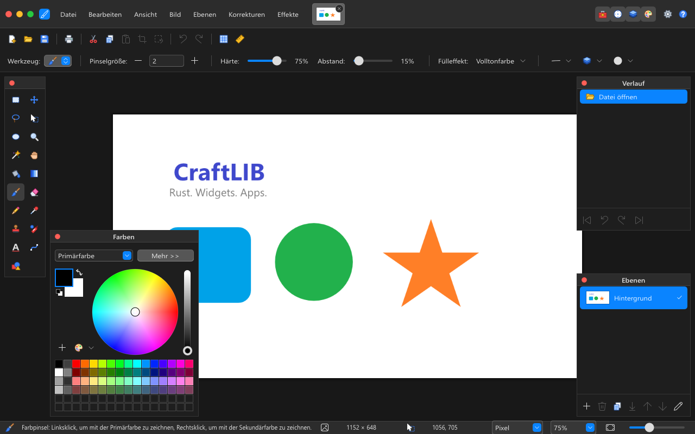
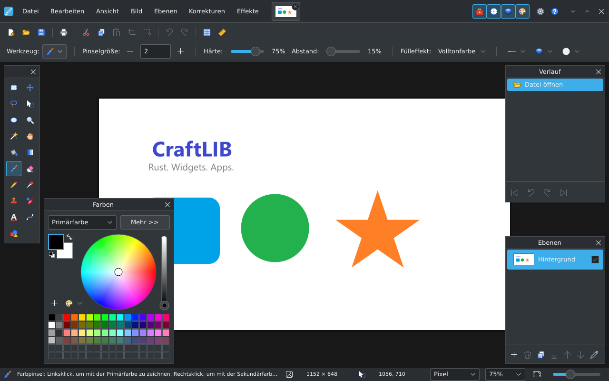

# PaintCraft

PaintCraft is a raster graphics editor inspired by paint.net, written in Rust with
[JFLib](../../README.md). It combines a layered canvas, multiple open documents,
selection tools, image adjustments, effects, and an extensible plugin system.

Use it for drawing, photo editing, compositing, and converting images between
formats. For a smaller drawing program, see
[Kritzel](../Kritzel/README.md).


*PaintCraft with the WinUI style and dark theme. German is the default UI language; English and French catalogs are also available.*

## More styles

### macOS style



*The same image, 75% zoom, and dark theme with JFLib's macOS style.*

### KDE style



*The same image, 75% zoom, and dark theme with JFLib's KDE style.*

These screenshots show JFLib style variants of the Windows build. The style
changes the app's appearance; the [build target](#build-and-run) selects its platform.

## Features

- **Documents and layers:** open several images in tabs; add, duplicate, reorder,
  merge, and hide layers; adjust layer opacity and blend modes; undo and redo edits.
- **Painting:** brush, pencil, eraser, flood fill, gradients, color picker, clone
  stamp, and recoloring, with bitmap brush tips, rotation, scatter, size/angle variation,
  flow, direction tracking, size, hardness, spacing, and pressure.
- **Selections:** rectangle, ellipse, lasso, and magic wand; combine selections,
  move selected pixels, and transform selections.
- **Text and shapes:** formatted text, lines and curves, built-in shapes, and
  custom shapes imported from XAML path geometry; OpenType shaping, bidirectional
  text, font fallback, selection and basic IME composition display.
- **Image editing:** crop, resize the image or canvas, rotate and flip, adjust
  colors and exposure, and apply blur, noise, distortion, artistic, and other effects.
- **Workspace:** floating Tools, Colors, History, and Layers panels; zoom, pan,
  rulers, pixel grid, light/dark themes, and the shared JFLib styles.
- **Extensibility:** native plugins for effects, adjustments, file types, and
  shapes; standalone G'MIC-Qt integration on Windows/Linux and an optional Windows
  host for original classic paint.net CPU effects and FileType factories, including
  execution from native Linux PaintCraft through Wine.

## Supported file formats

The following formats have both a decoder and an encoder registered by PaintCraft.
The extensions are the aliases recognized by its format registry. Support refers
to the app's raster-image workflow; it does not imply support for every feature or
variant of the corresponding file specification.

| Format | Extensions | Open | Save | Notes |
| --- | --- | :---: | :---: | --- |
| PNG | `.png` | Yes | Yes | Lossless images with transparency. |
| JPEG | `.jpg`, `.jpeg`, `.jpe`, `.jfif`, `.exif` | Yes | Yes | Lossy images; no alpha channel. |
| BMP | `.bmp`, `.dib`, `.rle` | Yes | Yes | Windows bitmap images. |
| GIF | `.gif` | Yes | Yes | Indexed color; opening an animation reads its first frame. |
| TIFF | `.tif`, `.tiff` | Yes | Yes | Raster images with format-specific compression and bit-depth options. |
| TGA | `.tga` | Yes | Yes | Targa raster images. |
| DDS | `.dds` | Yes | Yes | Texture images, with format-specific compression, mipmap, and cubemap options. |
| WebP | `.webp` | Yes | Yes | Lossy and lossless images with transparency. |
| AVIF | `.avif` | Yes | Yes | AV1-based images. |
| HEIC / HEIF | `.heic`, `.heif` | Yes | Yes | HEVC-based images in a HEIF container. |
| JPEG XL | `.jxl` | Yes | Yes | The additional `jxlenc` module supplies the enhanced encoder; see the build notes below. |
| JPEG XR | `.jxr`, `.wdp`, `.hdp`, `.wmp` | Yes | Yes | JPEG XR raster images. |
| paint.net document | `.pdn` | Yes | Yes | Preserves the document's raster layers; see below. |
| Photoshop PSD | `.psd` | Yes | Yes | Raster layers, names, visibility, opacity and supported blend modes; 8-bit layered RGB(A) export. |
| Photoshop PSB | `.psb` | Yes | No | Raster import, subject to PaintCraft's size/memory limits; save the converted document as PSD or PDN. |

### Layers, transparency, and document fidelity

**Use PDN or PSD to keep the supported raster layer stack.** PaintCraft reads and writes layer
pixels, names, visibility, opacity, and supported blend modes. Reading or writing
a PDN document does not require the paint.net plugin compatibility host.

Formats other than PDN and PSD are saved from the composited image. The file contains the visible
result, rather than independently editable PaintCraft layers. Text and shapes are
rasterized when committed to a layer.

PSD/PSB input accepts 8-, 16- and 32-bit RGB/grayscale data, using raw, PackBits,
ZIP or ZIP prediction. Raster layers retain their names, visibility, opacity,
pixels and ten compatible blend modes. Simple pixel masks are applied to alpha;
mask editing is not retained. 16-bit values are rounded to 8 bit. 32-bit linear
samples are clamped to 0–1 and converted to sRGB for the SDR canvas. This is not
HDR tone mapping or a guarantee of high-depth color-profile fidelity.

Photoshop groups, clipping, vector masks, layer effects and unsupported blend
modes fall back to the saved composite. Editable Photoshop text and smart objects
can supply raster previews, but their editable data is not retained. CMYK and Lab
are unsupported. Converted imports (including PSB, masks, off-canvas cropping and
higher bit depths) open as new unsaved documents with a warning; the source path
is not reused by normal Save. Other codecs reporting high-depth/HDR input also
use this protective import behavior. A simple supported 8-bit PSD can be edited
and saved directly. PSD export refuses blend modes it cannot represent.

The editing canvas uses 8-bit color channels. A codec's ability to read a
higher-bit-depth source does not make PaintCraft an HDR editor. Animated and
multi-page formats are used as individual images; the app has no animation or
multi-page document editor.

### Additional file types and assets

| Type | Extension | Usage |
| --- | --- | --- |
| QOI | `.qoi` | Open/save through the optional native `qoi` file-type plugin. |
| Color palettes | `.txt` | Load/save paint.net-style palettes: one `AARRGGBB` color per line. |
| Custom shapes | `.xaml` | Load supported path-based shapes from the app's `Shapes` directory. |

Other native file-type plugins can add their own extensions to the Open and Save
dialogs. QOI is an included example plugin, not part of the default codec set.

## Build and run

**Run these commands from the JFLib repository root**, where `build_rs.py` is
located. The app name is case-sensitive: **`PaintCraft`**.

You need Python 3, Rust/Cargo through rustup, and LLVM/LLD. The repository targets Rust
1.98.x. The Python script builds the app with `rustc` and the pinned shaping
dependencies with `cargo --locked`. The first build needs crates.io access (or
a populated Cargo cache). See the
[shared build prerequisites](../../README.md#prerequisites) for tool paths and
platform setup. Use `python3` instead of `python` where required.

### Windows

```powershell
rustup target add x86_64-pc-windows-msvc
python build_rs.py app PaintCraft --target win
.\build\win\PaintCraft.exe
```

To build and launch with an image and a dark theme:

```powershell
python build_rs.py run PaintCraft --target win -- --open "C:\Pictures\example.png" --theme dark
```

### Linux

```sh
rustup target add x86_64-unknown-linux-gnu
python3 build_rs.py app PaintCraft --target linux
./build/linux/PaintCraft
```

Running the desktop app requires a Wayland or X11 session. See the
[Linux build notes](../../README.md#linux-quick-start) for cross-building and WSL.

### Browser / WebAssembly

```sh
rustup target add wasm32-unknown-unknown
rustup component add rust-src
python build_rs.py app PaintCraft --target web
python tools/serve_web.py build/web/PaintCraft
```

Open [http://127.0.0.1:8766/](http://127.0.0.1:8766/). LLVM's `wasm-ld` is required.
For a smaller build that does not need `rust-src`, add `--web-mode scalar` to the
build command. See the [browser build guide](../../README.md#browser-builds) for
the SIMD and worker variants.

This app currently has `win`, `linux`, and `web` build targets. Native plugins and
the optional paint.net compatibility host are desktop features. Dedicated native
Android, macOS, and iOS app targets are not currently provided.

### Release builds and styles

```sh
# Optimized Windows build: build/release/win/PaintCraft.exe
python build_rs.py app PaintCraft --target win --release

# Separate style variants: build/win/<style>/PaintCraft.exe
python build_rs.py app PaintCraft --target win --style winui,classic,macos,kde,jfoffice
```

JFLib styles are selected when building. Theme and scale can be selected when
launching, for example `--theme dark --scale 150`.

The build script automatically builds PaintCraft's additional modules, including
`jxlenc.dll` on Windows and `jxlenc.so` on Linux. Keep the module beside the
executable when distributing a native build to retain the enhanced JPEG XL writer.
A fallback writer is available when the module is absent. Keep the generated
`licenses/` folder with the executable; it includes font and text-shaping notices.

### Build Manager

The same build can be configured through the graphical
[Build Manager](../buildManager/README.md):

```powershell
python build_rs.py app buildManager --target win
.\build\win\buildManager.exe
```

Select the JFLib repository and **PaintCraft**, choose the target and style
under **Development (Entwicklung)**, then select **Prepare jobs (Aufträge
vorbereiten)** and add the jobs to the queue. The GUI still requires Python, Rust,
and LLVM. The [Build Manager walkthrough](../../README.md#build-manager) covers
launch profiles, release builds, and packages.

## Plugins

### Native PaintCraft plugins

PaintCraft has its own **PNAPI** plugin interface. Native plugins are `.dll` files
on Windows and `.so` files on Linux, placed in `Effects`, `FileTypes`, or `Shapes`
beside the executable. They can provide effects, adjustments, file codecs, and
shapes. See the [native plugin guide](../../plugins/README.md).

For example, add QOI support to the default Windows build:

```powershell
python build_rs.py plugin qoi --target win
New-Item -ItemType Directory -Force .\build\win\FileTypes
Copy-Item .\build\win\plugins\qoi.dll .\build\win\FileTypes\qoi.dll
```

Restart PaintCraft after installing the plugin. For a release or style-specific
build, use the `FileTypes` directory beside that build's executable.

### Original paint.net plugins

A separate Windows host can run classic CPU `Effect`/`PropertyBasedEffect` plugins
and `FileType`/`IFileTypeFactory` plugins. On Windows it requires .NET 9 and a local
paint.net 5.1 installation; Paint.NET assemblies are not redistributed. Extract
plugins into `Effects`, `FileTypes` or `Shapes` and restart. The scanner identifies
managed assemblies separately from native PNAPI plugins and adds compatible
entries to menus/file filters. See the [host setup and compatibility matrix](../../tools/paintcraft-pdn-host/README.md).

Modern Bitmap/GPU effects, arbitrary Paint.NET host services and complete file-type
save dialogs are not implemented. Native Linux PaintCraft can invoke the same
host through Wine with explicit configuration. The tested setup uses Wine 11.19
and the experimental Paint.NET-on-Wine 5.200.9775.2252 package. The regular Windows
Paint.NET build failed its Direct2D initialization under Wine in this test.
The bridge includes path translation, catalog discovery, codecs, cancellation
and a heartbeat watchdog. See the [Linux setup](../../tools/paintcraft-pdn-host/README.md#linuxwine-setup)
for the required separate installation and precise compatibility boundaries.

### G'MIC and bitmap brushes

Install **G'MIC-Qt standalone** separately and open **Effects > G'MIC-Qt**. If it
is not on PATH, launch with `--gmic-qt /path/to/gmic_qt` or set
`PAINTCRAFT_GMIC_QT`. The active layer is exchanged as 8-bit PNG. A single result
of the same size is applied through the selection with one Undo step; multiple
outputs or a changed size open a new layered document. Cancel stops the helper.
See the [creative tools guide](docs/CREATIVE_TOOLS.md) for setup and limitations.

The brush icon beside the brush-size controls opens **Brush tip and dynamics**.
Load a PNG/BMP/TIFF tip and configure angle, scatter, size/angle variation, flow
and movement-direction tracking. PaintCraft also imports Brush Factory / Dynamic
Draw JSON and legacy XML presets for supported
controls. Active unsupported settings are listed and prevent application. Six
original MIT-licensed brush images, exact byte flow, stroke opacity caps and
accumulating dabs are included. This is partial preset compatibility; the original
Dynamic Draw DLL can also use the separate classic effect host. Interactive
painting in every version of that plugin is not covered by the automated tests.

### Language and text input

Choose **Settings > User interface > Language**, or launch with
`--language de`, `--language en` or `--language fr`. The selection is saved.
English and French cover menus and many common controls; untranslated labels,
status/error messages, shared dialogs and third-party plugin UIs may remain in
their original language. See [text behavior and tests](docs/TEXT.md).

## Work in progress and current limits

- **Photoshop fidelity:** editable masks, groups, text, smart objects, clipping,
  all blend modes, CMYK/Lab and PSB export remain open.
- **HDR and precision:** document pixels, Undo, tools/effects and display remain
  8-bit SDR. High-depth decoding is a conversion, not 16/32-bit editing or HDR output.
- **Original plugins:** modern Bitmap/GPU APIs and application-specific host services remain open;
  the classic Linux/Wine bridge is implemented and tested.
- **Creative plugins:** G'MIC currently receives one active 8-bit layer; Brush Factory
  advanced preset dynamics and full Brush Factory API compatibility remain incomplete.
- **Text/IME:** Windows IMM and Wayland text-input-v3 are wired up; automated tests
  cover preedit display and committed text. Real OS IME/candidate sessions still
  need acceptance testing. X11 IME, surrounding-text reconversion, full visual bidi
  cursor navigation and exhaustive script/font coverage remain open.
- **Localization:** English/French catalogs still have German fallback strings.

The [handbook comparison](docs/MANUAL_PARITY.md) records the current evidence and
remaining work; it does not claim complete Paint.NET or Photoshop parity.

## Related documentation

- [Source architecture and module responsibilities](docs/ARCHITECTURE.md)
- [JFLib library and app overview](../../README.md)
- [Layer behavior](docs/LAYERS.md), [selection tools](docs/SELECTION.md), and
  [image operations](docs/IMAGEOPS.md)
- [Effects](docs/EFFECTS.md), [G'MIC and bitmap brushes](docs/CREATIVE_TOOLS.md), and [color palettes](docs/COLORS.md)
- [Handbook comparison and regression tests](docs/MANUAL_PARITY.md)
- [Text-shaping dependency notices](../../lib/text_shape/NOTICE.md)
- [Native plugin development](../../plugins/README.md)
- [Packaging guide](../../docs/PACKAGING.md)
- [Kritzel: the smaller drawing app](../Kritzel/README.md)
